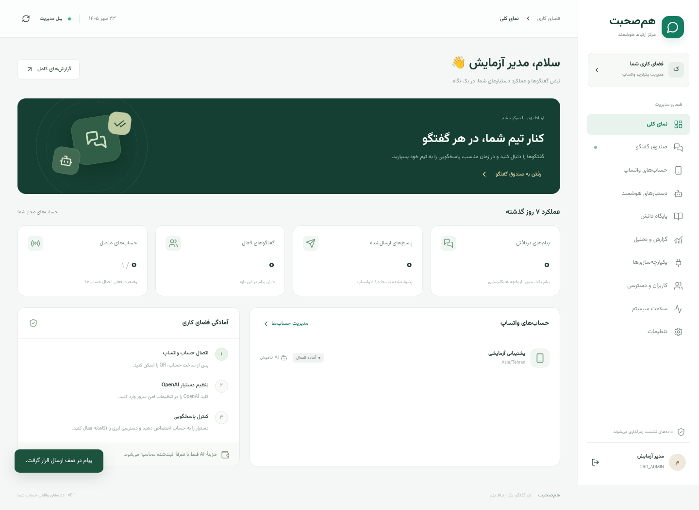

# هم‌صحبت — WhatsApp AI Manager

مرکز مکالمهٔ چندحسابی واتساپ با پنل فارسی، دستیار OpenAI، پاسخ اپراتور و گزارش حساب‌ها. مبنا: [سند معماری ارسالی](docs/architecture/specification.fa.md). انتخاب‌های شما: **OpenAI در شروع؛ مدل محلی قابل افزودن؛ CRM و SMS غیرفعال**.

## از اینجا شروع کنید

- **تازه‌کار هستید؟** [آموزش نصب از صفر روی سرور، با دستورهای قدم‌به‌قدم](docs/INSTALL.fa.md)
- **برنامه نصب شده است؟** [آموزش کامل استفاده از پنل](docs/USER-GUIDE.fa.md)
- **می‌خواهید وضعیت نسخه را بدانید؟** [محدودهٔ امکانات و موارد باقی‌مانده](docs/architecture/implementation-status.fa.md) و [نتایج آزمون‌ها](docs/validation.fa.md)



تصویر از محیط آزمایشی است؛ نصب تازه بدون مشتری و پیام نمونه شروع می‌شود. روش پیشنهادی استفادهٔ دائمی، Docker روی Ubuntu و دامنهٔ HTTPS است. روش زیر برای توسعه‌دهندگان است؛ کاربران غیر فنی از راهنمای نصب بالا شروع کنند.

## اجرای توسعه

پیش‌نیاز: Node **24.19.x**، pnpm **11.25.0**، Docker Compose v2، Python 3. PostgreSQL و Redis با Compose اجرا می‌شوند. نقطهٔ شروع پیشنهادی VPS: Linux، ۴ vCPU، ۸GB RAM، SSD؛ اندازه‌گیری واقعی قبل از استفادهٔ پرترافیک لازم است.

```bash
pnpm install --frozen-lockfile
pnpm setup:local
pnpm dev
```

`setup:local` فایل `.env` با رمزهای تصادفی محلی می‌سازد؛ فایل موجود را تغییر نمی‌دهد. اطلاعات ورود مدیر از `ADMIN_EMAIL` و `ADMIN_PASSWORD` همین فایل خوانده می‌شود. اطلاعات را فقط در محیط امن خود مشاهده کنید. حساب پیش‌فرض با رمز ثابت وجود ندارد. دستور `bootstrap` پس از وجود اولین کاربر، کاربر یا رمز او را تغییر نمی‌دهد.

پنل روی پورت **3000** و API روی **4000** اجرا می‌شود. مسیر API: `/api/v1`؛ مستندات نیازمند ورود: `/api/v1/docs` و `/api/v1/openapi.json`. تغییر کد backend به build و راه‌اندازی دوباره نیاز دارد؛ Next.js در حالت توسعه خودکار تازه می‌شود.

در محیط‌هایی با خانهٔ کاربر فقط‌خواندنی، پیش از نصب این مسیرهای محلی را تنظیم کنید:

```bash
export PNPM_HOME="$PWD/.local/pnpm"
export XDG_DATA_HOME="$PWD/.local/data"
export XDG_CACHE_HOME="$PWD/.local/cache"
export XDG_STATE_HOME="$PWD/.local/state"
pnpm install --frozen-lockfile
```

## اولین استفاده

1. وارد پنل شوید. در **تنظیمات**، ورود دومرحله‌ای را فعال و کدهای بازیابی را امن ذخیره کنید. فعال‌سازی، نشست‌های قبلی را باطل می‌کند. در Production، MFA برای نقش‌های مدیر و مدیر اتصال‌ها اجباری است.
2. در محیط امن سرور، `OPENAI_API_KEY` را وارد کنید و API و Job Worker را دوباره اجرا کنید. `LLM_API_KEY` نیز به‌عنوان نام جایگزین برای محیط‌هایی با نام‌های رزروشده پشتیبانی می‌شود. هیچ‌کدام در Git ذخیره نمی‌شوند.
3. از **دستیارهای هوشمند** دستیار بسازید؛ مدل پیش‌فرض قابل تغییر است. قبل از فعال‌سازی از شبیه‌ساز استفاده کنید؛ شبیه‌سازی پیام واتساپ ارسال نمی‌کند، اما مصرف API دارد.
4. از **حساب‌های واتساپ** حساب اضافه و QR را از بخش دستگاه‌های متصل واتساپ اسکن کنید. ابتدا از حساب آزمایشی استفاده کنید.
5. دستیار را به حساب اختصاص دهید؛ اجازهٔ ارسال داده به مدل ابری و پاسخ AI را جداگانه فعال کنید. تا آن زمان پاسخ خودکار خاموش است.
6. مشتری پیام متنی بفرستد؛ گفتگو در صندوق ظاهر می‌شود. حالت‌ها: AI، انسانی، دستیار با تأیید انسان، و توقف. ارسال دستی تنها در حالت HUMAN/ASSIST مجاز است.

برای مدل محلی، یک سرویس **سازگار با OpenAI Chat Completions** راه‌اندازی کنید، `LOCAL_LLM_URL` را به مسیر `/v1` آن بدهید و `LOCAL_LLM_MODEL` را تنظیم کنید. در نسخهٔ دستیار، provider را `local` و model را نام مدل نصب‌شده قرار دهید. مثال محیط: `LOCAL_LLM_URL=http://ollama:11434/v1`. خودِ مدل، GPU و Ollama/vLLM در این پروژه نصب یا دانلود نمی‌شوند.

## قابلیت‌های پیاده‌شده

- حساب‌ها و نشست‌های مستقل؛ QR کوتاه‌عمر؛ Auth و Signal Keys با AES-256-GCM و اتصال ciphertext به حساب؛ مالکیت نشست با lease و fencing.
- نرمال‌سازی متن و JID؛ نگاشت PN/LID؛ دریافت چندپیامی؛ جلوگیری از پاسخ به تاریخچه، پیام خودی و پیام قدیمی؛ Inbox/Outbox تراکنشی و بازیابی رویدادهای مصرف‌نشده پس از از‌دست‌رفتن Redis.
- نسخهٔ مکالمه، جلوگیری از رقابت AI/انسان، حالت ASSIST، پاسخ دستی idempotent، یادداشت، تگ، بستن گفتگو، درخواست اپراتور و STOP.
- ارسال با وضعیت مستقل `UNKNOWN_DELIVERY`؛ ارسال نامشخص خودکار تکرار نمی‌شود. درگاه هنگام ارسال نسخه، حالت، مالکیت و توقف سراسری را دوباره بررسی می‌کند.
- دستیار نسخه‌دار، OpenAI و ارائه‌دهندهٔ محلی، تجمیع پیام‌های نزدیک، تاریخچهٔ محدود، دانش متنی مبتنی بر FTS، مصرف توکن و هزینهٔ مبتنی بر تعرفهٔ همان نسخه.
- آمار روزانه، مقایسهٔ حساب، صدک زمان اولین پاسخ، مصرف AI، وضعیت تحویل و اتصال، CSV/XLSX خصوصی با اعتبار ۲۴ ساعت.
- رمز عبور Argon2id، Cookie امن، CSRF و Origin Check، کنترل نقش و حساب، MFA و recovery code، ممیزی، توکن‌های خواندن گزارش با محدودهٔ حساب، انقضا و ابطال.
- حذف/ناشناس‌سازی اطلاعات مخاطب و متن تاریخچهٔ ادغام‌شده؛ نگهداری محتوای پیام بر اساس سیاست سازمان (پیش‌فرض ۳۶۵ روز). raw پروتکل رمزگذاری‌شده پس از ۷ روز پاک می‌شود.
- API نسخه‌دار، Swagger، اعلان‌های WebSocket بدون متن پیام، بازیابی UI از REST، وضعیت Workerها، Compose، Caddy و CI.

CRM و SMS طبق انتخاب شما غیرفعال‌اند؛ آداپترِ یک سرویس ناشناخته و عملیات واقعی بیرونی ادعا نشده است. این نسخه مسیر متنی نسخهٔ اول سند را پوشش می‌دهد. جزئیات پوشش و موارد مرحلهٔ پیشرفته در [ماتریس تحویل](docs/architecture/implementation-status.fa.md) آمده است.

## ساخت و آزمون

نتایج اجراشده در محیط توسعه: [گزارش اعتبارسنجی](docs/validation.fa.md).

```bash
pnpm lint
pnpm typecheck
pnpm test
pnpm test:integration
pnpm test:e2e
pnpm test:load
pnpm test:restore
pnpm build
pnpm audit --prod --audit-level moderate
```

آزمون یکپارچه و مرورگر، دیتابیس موقت با نام `wa_test_*` یا `wa_ui_test_*` می‌سازد و فقط همان دیتابیس را حذف می‌کند؛ کاربر دیتابیس آزمایش باید حق `CREATE DATABASE` داشته باشد. PostgreSQL/Redis محلی باید فعال باشند. تست‌ها به شمارهٔ واتساپ یا کلید OpenAI وصل نمی‌شوند. مرورگر از Chromium سیستم یا مرورگر نصب‌شدهٔ Playwright استفاده می‌کند:

```bash
pnpm exec playwright install chromium
```

`test:e2e` پنل روی پورت 3001 و API موقت روی 4011 را اجرا می‌کند. تست بار، baseline مصنوعی سه حساب است و تضمین ظرفیت واتساپ یا سرعت LLM محسوب نمی‌شود.

پس از ساخت دو تصویر `whatsapp-ai-server:0.1.0` و `whatsapp-ai-web:0.1.0`، فرمان `pnpm test:containers` مهاجرت، bootstrap، سلامت API/Worker، الزام MFA در Production، پنل standalone و اجرای non-root را بررسی می‌کند. این آزمون از PostgreSQL محیط development، دیتابیس موقت و Redis جدا استفاده می‌کند و کانتینرهای آزمایش را در پایان حذف می‌کند.

## استقرار

[راهنمای استقرار و عملیات](docs/runbooks/deployment.fa.md)، [پشتیبان‌گیری و بازیابی](docs/runbooks/recovery.fa.md)، [تعریف شاخص‌ها](docs/reports/metric-dictionary.md).

```bash
docker compose --env-file .env -f infrastructure/compose/production.yaml build
docker compose --env-file .env -f infrastructure/compose/production.yaml up -d
docker compose --env-file .env -f infrastructure/compose/production.yaml --profile bootstrap run --rm bootstrap
```

قبل از اجرای Production، مقادیر واقعی `PUBLIC_HOST`، `APP_ORIGIN=https://...`، رمز قوی دیتابیس، `MASTER_KEY` و حساب مدیر را تنظیم کنید. هیچ پورتی از PostgreSQL یا Redis در Compose تولیدی عمومی نمی‌شود. نسخهٔ تولیدی از Cookie با `Secure` استفاده می‌کند و باید پشت HTTPS باز شود.

اتصال واقعی واتساپ نیازمند اسکن QR و دسترسی شبکه به WhatsApp است؛ عملکرد واقعی مدل نیازمند کلید OpenAI یا سرویس محلی است. ساخت و تست داخلی، جای این دو آزمون خارجی را نمی‌گیرد.
