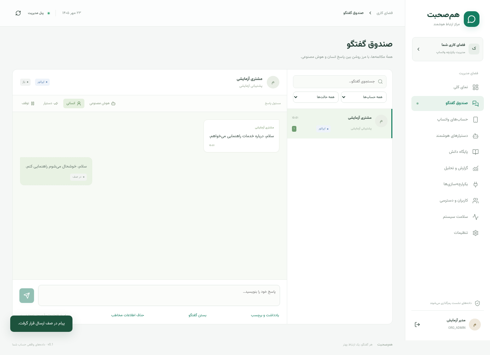

# آموزش استفاده از پنل هم‌صحبت

این آموزش پس از [نصب و اولین ورود](INSTALL.fa.md) استفاده می‌شود. تصاویر با دادهٔ آزمایشی گرفته شده‌اند؛ مشتری یا شمارهٔ واقعی نیستند. نسخهٔ اولیه دادهٔ نمایشی به حساب شما اضافه نمی‌کند، بنابراین خالی‌بودن پنل تازه طبیعی است.

## ۱. آشنایی با صفحهٔ اصلی


منوی سمت راست راه ورود به قسمت‌هاست. در موبایل دکمهٔ سه‌خط بالای صفحه منو را باز می‌کند. بعضی گزینه‌ها فقط برای مدیر نمایش داده می‌شوند. اگر کاربر شما اپراتور است، نداشتن دسترسی به ساخت حساب واتساپ یا تنظیمات سازمان طبیعی است.

صفحهٔ اصلی تعداد پیام‌ها، گفتگوها و حساب‌ها را نشان می‌دهد. گزارش‌ها از دادهٔ ذخیره‌شده و پردازش پس‌زمینه ساخته می‌شوند؛ ممکن است چند ثانیه با صندوق اختلاف داشته باشند. صفر به‌معنای دادهٔ ثبت‌شدهٔ صفر است؛ برای اطلاعات ناموجود نباید نتیجهٔ فرضی برداشت کرد.

## ۲. ساخت دستیار

وارد **دستیارهای هوشمند → دستیار جدید** شوید:

| فیلد | چه چیزی بنویسم؟ |
|---|---|
| نام | یک عنوان داخلی مثل «راهنمای فروش» |
| ارائه‌دهنده | فعلاً `openai`؛ مدل محلی را بعد از نصب سرویس مربوط انتخاب کنید |
| مدل | نام دقیق مدل قابل دسترس در حساب API شما |
| دستور رفتاری | توضیح وظیفه، زبان پاسخ، حدود پاسخ و زمان نیاز به اپراتور |
| سقف توکن خروجی | سقف طول پاسخ؛ توکن واحد شمارش مدل است، نه تعداد دقیق کلمه |
| زمان تجمیع پیام | چند ثانیه صبر برای پیام‌های نزدیک مشتری؛ مقدار کم، پاسخ سریع‌تر و احتمال درخواست بیشتر به مدل دارد |
| تعرفهٔ ورودی/خروجی | قیمت دلاری هر یک میلیون توکن از تعرفهٔ معتبر همان مدل؛ اگر ندارید خالی بگذارید |

نمونهٔ دستور رفتاری قابل ویرایش:

```text
تو دستیار فارسی پشتیبانی فروشگاه ما هستی.
با لحن محترمانه و کوتاه پاسخ بده.
اطلاعات قیمت، موجودی و شرایط را فقط از دانش تأییدشده بگو.
اگر اطلاعات کافی نداری، سؤال مشخص بپرس و چیزی اختراع نکن.
ادعا نکن سفارش ثبت، پرداخت انجام یا تیکت ساخته شده است.
برای کارهایی که به بررسی انسان نیاز دارند، نیاز به اپراتور را روشن توضیح بده.
```

صرف نوشتن جمله‌ای در prompt، اتصال CRM یا عملیات واقعی ایجاد نمی‌کند. درخواست صریح مشتری برای اپراتور در مسیر برنامه مدیریت می‌شود؛ هر ابهام مدل لزوماً به‌صورت خودکار حالت گفتگو را عوض نمی‌کند.

**ذخیره نسخه** را بزنید. تغییرات بعدی نسخهٔ تازه می‌سازند؛ تاریخچهٔ محاسبهٔ هزینه بر اساس نسخهٔ زمان اجراست. سپس گزینهٔ آزمایش/شبیه‌ساز را باز و یک پیام نمونه وارد کنید. هزینهٔ شبیه‌ساز از API شما مصرف می‌شود اما پیام واتساپ نمی‌فرستد. موفقیت شبیه‌ساز فقط مدل را بررسی می‌کند؛ اتصال شماره هنوز مرحلهٔ جداست.

## ۳. افزودن حساب واتساپ

1. **حساب‌های واتساپ → افزودن حساب** را باز کنید.
2. نامی روشن مثل «پشتیبانی شعبهٔ تهران» بنویسید.
3. منطقهٔ زمانی را انتخاب کنید؛ برای ایران `Asia/Tehran` مناسب است.
4. حساب را بسازید و اتصال را شروع کنید.
5. QR نمایش‌داده‌شده را از قسمت دستگاه‌های متصل واتساپ گوشی اسکن کنید. اگر QR منقضی شد، QR تازه را از همان پنجره بگیرید.
6. پس از نمایش «متصل»، تنظیمات حساب را باز کنید، دستیار را انتخاب کنید و در صورت موافقت، اجازهٔ مدل ابری و پاسخ هوشمند را فعال کنید.

اجازهٔ مدل ابری یعنی متن لازم برای پاسخ به ارائه‌دهندهٔ مدل فرستاده می‌شود. این انتخاب را مطابق اطلاعات کسب‌وکار و سیاست خودتان انجام دهید. کلید فعال‌بودن AI حساب با حالت هر گفتگو و توقف سراسری سازمان ترکیب می‌شود؛ روشن‌بودن فقط یکی از آن‌ها کافی نیست.

| وضعیت حساب | معنی |
|---|---|
| آماده اتصال | حساب ساخته شده ولی هنوز متصل نیست |
| در انتظار اسکن | QR آماده است |
| متصل | نشست واتساپ برقرار است |
| اتصال مجدد | درگاه تلاش محدود برای برقراری دوباره دارد |
| نیاز به اتصال دوباره | نشست خارج شده؛ اتصال صریح و QR تازه لازم است |
| نیاز به بررسی | مشکل اتصال یا ذخیره‌سازی؛ سلامت سیستم و لاگ‌ها را بررسی کنید |

اگر می‌خواهید فقط AI را متوقف کنید، کلید AI یا حالت گفتگو را تغییر دهید. **قطع اتصال حساب** ارتباط خود واتساپ را متوقف می‌کند و بر دریافت و ارسال هر دو اثر دارد.

## ۴. صندوق گفتگو و پاسخ اپراتور



از **صندوق گفتگو**، حساب یا حالت موردنظر را فیلتر و گفتگو را باز کنید. فهرست صفحه‌بندی شده است؛ برای موارد قدیمی‌تر از گزینهٔ دریافت بیشتر استفاده کنید. حالت بالای گفتگو تعیین می‌کند چه کسی پاسخ می‌دهد:

| حالت | رفتار |
|---|---|
| هوش مصنوعی / AI | پیام تازه و مجاز می‌تواند پاسخ خودکار تولید کند |
| انسانی / HUMAN | اپراتور پاسخ می‌نویسد؛ پاسخ خودکار تازه متوقف می‌شود |
| دستیار / ASSIST | AI پیش‌نویس می‌دهد؛ اپراتور متن را بررسی و ارسال می‌کند |
| توقف / PAUSED | پاسخگویی متوقف است؛ برای ارسال دستی ابتدا HUMAN یا ASSIST را انتخاب کنید |

### گرفتن گفتگو از AI

1. گفتگو را باز کنید و **انسانی** را بزنید.
2. آخرین پیام‌ها را بخوانید.
3. پاسخ را در کادر پایین بنویسید و ارسال را بزنید.
4. وضعیت پیام را بررسی کنید؛ «در صف» معادل تحویل روی گوشی مقصد نیست.

اگر AI هنوز در حال پردازش باشد، نتیجهٔ قدیمی پس از تغییر حالت اجازهٔ ارسال تازه ندارد. پیام قبلاً فرستاده‌شده در شبکه قابل پس‌گرفتن نیست. اگر هنگام اقدام شما نسخهٔ گفتگو عوض شده باشد، برنامه ممکن است درخواست تازه‌سازی بدهد؛ وضعیت جدید را بخوانید و اقدام را تکرار کنید.

### معنی وضعیت ارسال

| وضعیت | اقدام اپراتور |
|---|---|
| در صف / در حال ارسال | کمی صبر و وضعیت اتصال را بررسی کنید |
| پذیرفته‌شده | درگاه شناسهٔ پیام گرفته؛ هنوز معادل خوانده‌شدن نیست |
| تحویل‌شده / خوانده‌شده | رسید مربوط از سرویس دریافت شده است |
| لغوشده | شرایط ارسال مثل حالت یا نسخه عوض شده؛ وضعیت گفتگو را بررسی کنید |
| ناموفق | علت را بررسی کنید؛ پیش از ارسال دوباره مطمئن شوید پیام قبلی ارسال نشده است |
| تحویل نامشخص / UNKNOWN_DELIVERY | شبکه نتیجهٔ قطعی نداده است؛ برنامه خودکار تکرار نمی‌کند تا پیام دوباره نرود |

در حالت تحویل نامشخص، روی دستگاه/گفتگو و رسیدهای بعدی بررسی کنید و بی‌اطلاع از نتیجه دوباره نفرستید.

### یادداشت، برچسب و بستن گفتگو

گزینهٔ **یادداشت و برچسب** برای اطلاعات داخلی تیم است؛ یادداشت پیام مشتری نیست و برای واتساپ ارسال نمی‌شود. برچسب‌هایی مانند «پیگیری» و «فروش» کمک می‌کنند موضوع مشخص باشد. پس از رسیدگی، گفتگو را ببندید. تغییر حالت یا بازکردن مجدد را آگاهانه انجام دهید.

گزینهٔ **حذف اطلاعات مخاطب** برای مدیر، داده‌های شخصی و متن تاریخچهٔ مربوط را ناشناس می‌کند و پاسخ‌های در انتظار را متوقف می‌کند. این کار برای مرتب‌کردن ظاهری صندوق نیست و برگشت ساده ندارد؛ فقط وقتی واقعاً قصد حذف اطلاعات دارید استفاده کنید.

پیام‌های تاریخچه، پیام خودِ شماره، پیام‌های قدیمی، گروه‌ها و محتوای رسانه‌ای مسیر پاسخ متنی نسخهٔ اول نیستند. آزمون را با متن تازه از یک شمارهٔ دیگر انجام دهید. پیام STOP مشتری پاسخگویی را متوقف می‌کند؛ این توقف را بدون توجه به خواستهٔ مشتری دور نزنید.

## ۵. افزودن دانش کسب‌وکار

در **پایگاه دانش** ابتدا حساب را انتخاب و **دانش جدید** را بزنید. عنوان و متن تأییدشده را ثبت کنید؛ مثلاً ساعات کاری، روش مرجوعی یا پرسش‌های متداول. سند برای همان حساب استفاده می‌شود.

متن کوتاه، روشن و به‌روز بهتر است. رمز، کلید API و اطلاعات غیرضروری مشتری را در دانش قرار ندهید. در نسخهٔ فعلی ورود متن و FAQ پشتیبانی می‌شود؛ بارگذاری PDF یا استخراج خودکار فایل وجود ندارد. پس از تغییر دانش، با یک سؤال واقعی اما غیرحساس رفتار پاسخ را بررسی کنید.

## ۶. گزارش و فایل خروجی

در **گزارش و تحلیل** حساب، بازهٔ تاریخ و منطقهٔ زمانی را انتخاب کنید. نمودار پیام‌ها، مقایسهٔ حساب‌ها و اطلاعات مصرف AI بر همان فیلترها متکی‌اند. دادهٔ گزارش ممکن است با تأخیر کوتاه به‌روز شود.

صدک ۹۵ یعنی ۹۵ درصد نمونه‌های محاسبه‌شده از آن مقدار بیشتر نبوده‌اند؛ آن را با میانگین اشتباه نگیرید. نمونهٔ کم یا تعرفهٔ ثبت‌نشده، مبنای نتیجه‌گیری قطعی نیست. هزینهٔ گزارش، برآورد از توکن و تعرفهٔ ثبت‌شده است؛ صورتحساب رسمی OpenAI مرجع پرداخت است. تعریف دقیق شاخص‌ها در [فرهنگ شاخص‌ها](reports/metric-dictionary.md) آمده است.

برای خروجی، CSV یا XLSX را انتخاب کنید، تا وضعیت آماده صبر کنید و دانلود کنید. فایل‌ها خصوصی، وابسته به دسترسی حساب و درخواست‌کننده و موقت با اعتبار ۲۴ ساعت‌اند. بعد از انقضا دوباره خروجی بسازید. خروجی دادهٔ خصوصی کسب‌وکار را مانند سند داخلی نگه دارید.

## ۷. افزودن همکار

مدیر از **کاربران و دسترسی → کاربر جدید**، نام، ایمیل، رمز یکتا، نقش و حساب‌های مجاز را تعیین می‌کند. رمز باید حداقل ۱۲ نویسه باشد. آن را از مسیر امن به همکار بدهید؛ سامانه ایمیل دعوت نمی‌فرستد.

| نقش | استفادهٔ معمول |
|---|---|
| مدیر سازمان | تنظیم حساب‌ها، دستیارها، کاربران و کنترل سراسری |
| سرپرست | نظارت گفتگوها و گزارش حساب‌های مجاز |
| اپراتور | رسیدگی به گفتگوهای حساب‌های مجاز |
| تحلیل‌گر | مشاهدهٔ گزارش حساب‌های مجاز |
| مدیر اتصال‌ها | مدیریت محدودهٔ اتصال‌ها؛ CRM/SMS فعلاً غیرفعال‌اند |
| ممیز | بررسی رویدادهای ممیزی |

برای کاربران غیرمدیر حساب‌های مجاز را مشخص کنید؛ دسترسی خالی به‌معنای اجازهٔ همهٔ حساب‌ها نیست. ویرایش دسترسی یا غیرفعال‌کردن کاربر، نشست‌های قبلی او را باطل می‌کند. توکن خواندن گزارش از API مدیریت می‌شود؛ در نسخهٔ فعلی فرم مدیریت توکن در پنل وجود ندارد.

## ۸. توقف سراسری و سلامت سیستم

در **تنظیمات**، مدیر می‌تواند پاسخ خودکار تمام حساب‌ها را متوقف کند. این انتخاب ارسال تازهٔ AI را متوقف می‌کند؛ پاسخ دستی در حالت مجاز همچنان امکان‌پذیر است. تنظیم MFA هر کاربر نیز در صفحهٔ تنظیمات خودش قرار دارد.

در **سلامت سیستم**، فعالیت درگاه واتساپ، پردازش پس‌زمینه، صف و ارسال‌های نامشخص را ببینید. وجود کلید OpenAI در این صفحه فقط موجودبودن تنظیم را نشان می‌دهد؛ اعتبار کلید و دسترسی مدل با شبیه‌ساز بررسی می‌شود. متصل‌بودن خود API به‌تنهایی سلامت شمارهٔ واتساپ را ثابت نمی‌کند.

## ۹. تمرین پذیرش قبل از استفادهٔ روزمره

با شمارهٔ آزمایشی و بدون دادهٔ حساس این موارد را انجام دهید:

1. ورود با MFA و خروج/ورود دوباره.
2. ساخت دستیار، آزمایش پاسخ و اتصال QR.
3. ارسال یک پیام تازه از گوشی دیگر و بررسی پاسخ واقعی.
4. انتخاب HUMAN هنگام پردازش و ارسال پاسخ دستی.
5. انتخاب ASSIST و بررسی اینکه پیش‌نویس خودکار ارسال نمی‌شود.
6. خاموش‌کردن AI حساب و توقف سراسری و بررسی اثر هر کدام.
7. مشاهدهٔ گزارش و دریافت یک فایل خروجی.
8. ورود یک اپراتور با فقط یک حساب و بررسی محدودبودن دسترسی او.
9. تهیهٔ backup و انجام restore آزمایشی جدا با مسئول فنی.

مواردی که در آزمون زنده تأیید نشده‌اند را ثبت کنید. برای تغییرات سرور و رفع خطا از [راهنمای نصب](INSTALL.fa.md) و [راهنمای عملیات](runbooks/deployment.fa.md) استفاده کنید.
