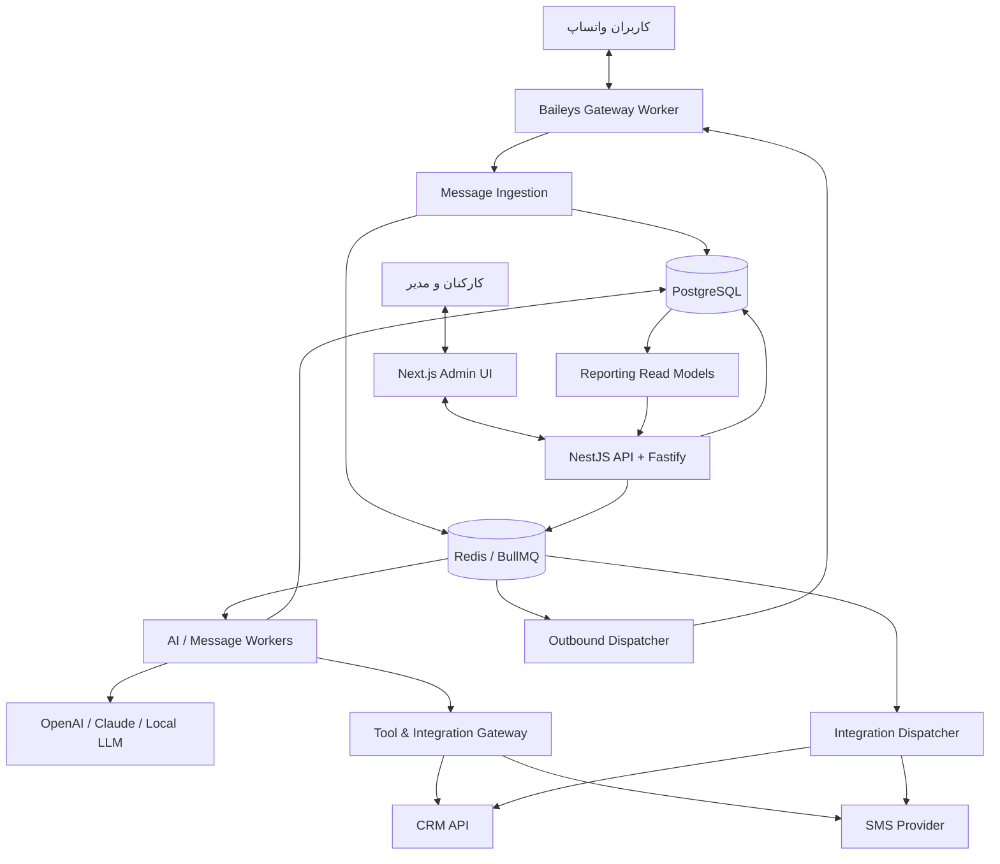
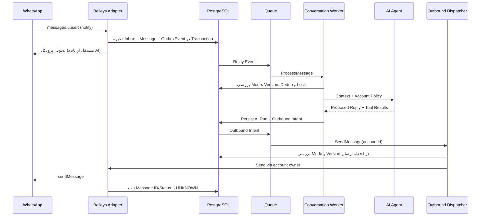
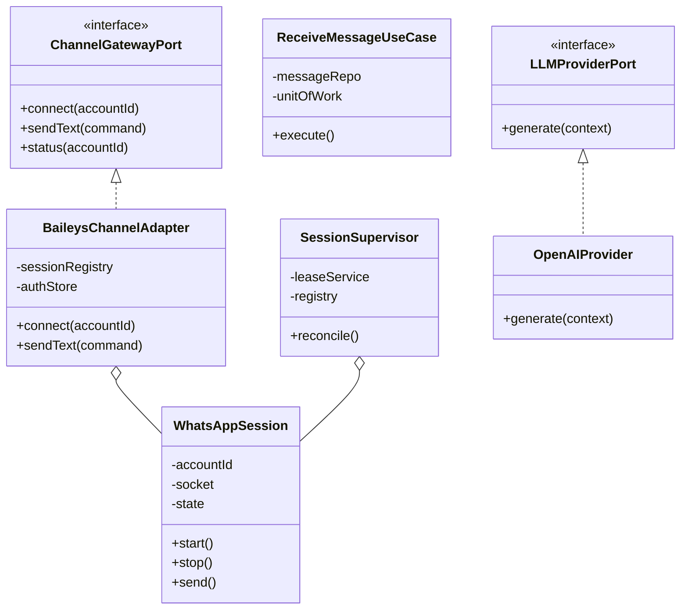
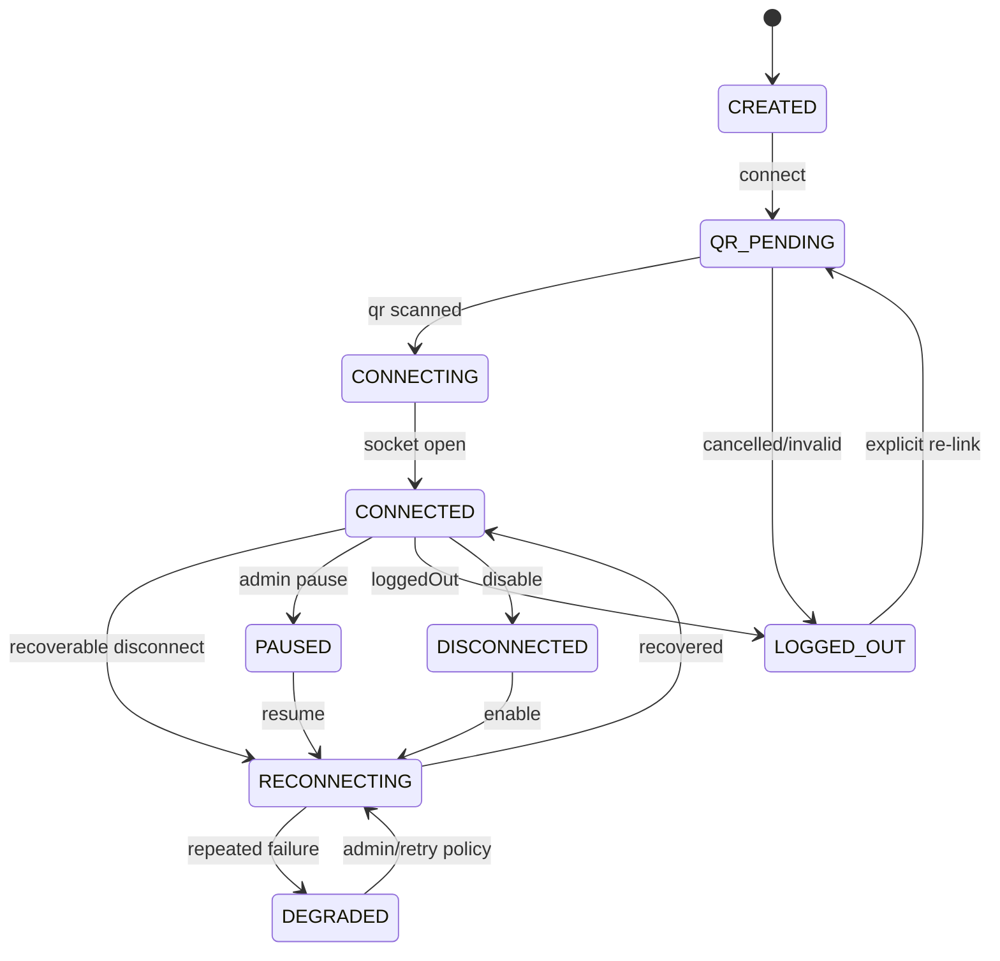

# سند معماری نهایی سامانه WhatsApp AI Agent

> **نسخه سند:** 1.0  
> **تاریخ:** ۱۴ اکتبر ۲۰۲۶  
> **وضعیت:** طرح فنی قابل تبدیل به بک‌لاگ و پیاده‌سازی؛ نه کد آماده Production  
> **مخاطب:** معمار نرم‌افزار، تیم Backend، Frontend، DevOps، QA و توسعه‌دهندگان AI  
> **پلتفرم:** سرور اختصاصی یا VPS، چند حساب واتساپ متعلق به یک کسب‌وکار، Baileys بدون WhatsApp Business API رسمی

---

## فهرست مطالب

1. [چکیده و تصمیم قطعی](#1-چکیده-و-تصمیم-قطعی)
2. [دامنه، فرض‌ها و محدودیت‌ها](#2-دامنه-فرضها-و-محدودیتها)
3. [نیازمندی‌های عملکردی و غیرعملکردی](#3-نیازمندیهای-عملکردی-و-غیرعملکردی)
4. [الگوی معماری و مرزهای وابستگی](#4-الگوی-معماری-و-مرزهای-وابستگی)
5. [نمودارهای کلان و جریان اطلاعات](#5-نمودارهای-کلان-و-جریان-اطلاعات)
6. [ساختار Monorepo و ماژول‌ها](#6-ساختار-monorepo-و-ماژولها)
7. [طراحی کاملاً شی‌گرا و قرارداد کلاس‌ها](#7-طراحی-کاملاً-شیگرا-و-قرارداد-کلاسها)
8. [لایه Baileys و مدیریت چند نشست](#8-لایه-baileys-و-مدیریت-چند-نشست)
9. [ورود پیام، صف‌ها و ارسال مطمئن](#9-ورود-پیام-صفها-و-ارسال-مطمئن)
10. [مدیریت گفتگو و دخالت اپراتور](#10-مدیریت-گفتگو-و-دخالت-اپراتور)
11. [موتور هوش مصنوعی و مدل‌های قابل تعویض](#11-موتور-هوش-مصنوعی-و-مدلهای-قابل-تعویض)
12. [سیستم افزونه و یکپارچه‌سازی CRM و SMS](#12-سیستم-افزونه-و-یکپارچهسازی-crm-و-sms)
13. [طراحی دیتابیس و ایندکس‌ها](#13-طراحی-دیتابیس-و-ایندکسها)
14. [گزارش‌گیری پیشرفته، KPI و تحلیل هر حساب](#14-گزارشگیری-پیشرفته-kpi-و-تحلیل-هر-حساب)
15. [طراحی API و قراردادهای عمومی](#15-طراحی-api-و-قراردادهای-عمومی)
16. [پنل مدیریت و تجربه کاربری](#16-پنل-مدیریت-و-تجربه-کاربری)
17. [امنیت، حریم خصوصی و سطوح دسترسی](#17-امنیت-حریم-خصوصی-و-سطوح-دسترسی)
18. [سبک‌سازی، کارایی و ظرفیت](#18-سبکسازی-کارایی-و-ظرفیت)
19. [استقرار، مانیتورینگ و بازیابی](#19-استقرار-مانیتورینگ-و-بازیابی)
20. [تست، استاندارد کد و CI/CD](#20-تست-استاندارد-کد-و-cicd)
21. [نقشه راه، خروجی مراحل و معیار پذیرش](#21-نقشه-راه-خروجی-مراحل-و-معیار-پذیرش)
22. [تصمیم‌های ثبت‌شده ADR](#22-تصمیمهای-ثبتشده-adr)
23. [بک‌لاگ اولیه و موارد خارج از دامنه](#23-بکلاگ-اولیه-و-موارد-خارج-از-دامنه)
24. [مراجع فنی بررسی‌شده](#24-مراجع-فنی-بررسیشده)

---

## 1. چکیده و تصمیم قطعی

این نرم‌افزار یک **مرکز مکالمه چندحسابی با ایجنت هوش مصنوعی** است. هر شماره واتساپ حساب و نشست مستقلی دارد، اما کارکنان و مدیران در یک پنل می‌توانند گفتگوها، تنظیمات ایجنت، هزینه‌ها، کیفیت پاسخ و گزارش‌های هر حساب را مشاهده کنند. سیستم باید بدون تغییر هسته، امکان اتصال بعدی به CRM، سامانه پیامکی، ERP، سیستم رزرو و APIهای خارجی را داشته باشد.

### معماری مصوب

**Modular Monolith + Hexagonal Architecture (Ports & Adapters) + DDD تاکتیکی سبک + Event-Driven Background Processing + CQRS سبک برای گزارش‌ها**.

- **Modular Monolith**: منطق دامنه و مدیریت API در یک مخزن و چند ماژول دارای مرز مشخص؛ بدون پیچیدگی زودهنگام Microservices.
- **Hexagonal**: منطق کسب‌وکار هیچ import مستقیمی از Baileys، دیتابیس، SDK مدل‌ها یا سرویس پیامکی ندارد.
- **DDD سبک**: Entity، Value Object، Domain Service، Application Service، Repository Port و رویدادهای دامنه برای قابلیت‌های مهم؛ نه ساخت صدها کلاس تزئینی.
- **پردازش پس‌زمینه**: اتصال زنده حساب‌ها و پردازش صف‌ها خارج از درخواست HTTP، ولی با همان کدهای Domain/Application.
- **CQRS سبک**: تراکنش‌های اصلی از مدل دامنه انجام می‌شوند؛ کوئری‌های تحلیلی از Read Model و جدول‌های تجمیعی. بدون Event Sourcing کامل.

### فناوری‌های تثبیت‌شده

| بخش | انتخاب | توجیه |
|---|---|---|
| زبان | TypeScript با `strict: true` | قراردادهای قابل کنترل، OOP و یکپارچگی تیم |
| Runtime | Node.js LTS تست‌شده و نسخه قفل‌شده | Baileys و اکوسیستم Node |
| Backend | NestJS + Fastify Adapter | DI، تست‌پذیری و HTTP کم‌هزینه |
| Frontend | Next.js + TypeScript، نمایش RTL فارسی | رابط مدیریتی و توسعه آسان |
| اتصال واتساپ | `@whiskeysockets/baileys` پشت `IChannelGateway` | بدون Chrome و مستقل از هسته |
| ORM | Drizzle ORM + SQL Migrations | سبک، typed، کنترل مستقیم SQL و گزارش‌ها |
| داده اصلی | PostgreSQL | تراکنش، ایندکس، JSONB، آمار |
| صف‌ها و کش | Redis + BullMQ | Jobs، Retry، Debounce؛ با حفظ منبع حقیقت در PostgreSQL |
| فایل‌ها | فضای فایل خصوصی محلی در MVP؛ S3/MinIO در مقیاس بالاتر | کاهش مصرف RAM و استقلال زیرساخت |
| LLM | OpenAI / Claude / Ollama / vLLM از طریق Port | انتخاب مدل به‌ازای حساب/ایجنت |
| RAG | PostgreSQL FTS؛ `pgvector` اختیاری در فاز بعدی | پرهیز از زیرساخت بلااستفاده |
| نمودارها | کتابخانه سبک Frontend با Dynamic Import | جلوگیری از بارگذاری نمودار در Inbox |
| API | REST `/api/v1` + WebSocket محدود + OpenAPI | نسخه‌بندی، اتصال CRM و کلاینت‌های بعدی |
| عملیات | Docker Compose، Caddy، Pino، OpenTelemetry | راه‌اندازی قابل نگهداری روی VPS |

> **تصمیم سبک‌سازی:** هر حساب واتساپ لزوماً کانتینر یا پردازش Node مستقل ندارد. یک `Gateway Worker` می‌تواند چند Socket مستقل را زیر نظر Supervisor نگه دارد. ایزوله‌سازی خطا در سطح حساب با Lifecycle جدا، محدودسازی منابع، Circuit Breaker و امکان انتقال حساب به Worker دیگر انجام می‌شود. اگر بعداً ایزوله‌سازی پردازشی ضروری شد، قرارداد Gateway بدون تغییر می‌ماند.

---

## 2. دامنه، فرض‌ها و محدودیت‌ها

### داخل دامنه

1. اتصال هم‌زمان چند شماره متعلق به یک کسب‌وکار؛ افزودن، توقف، قطع و بازاتصال هر حساب به شکل مستقل.
2. دریافت و ارسال پیام متنی؛ طراحی قابل توسعه برای تصویر، صوت، سند و ویدئو.
3. ثبت تمامی پیام‌های پشتیبانی‌شده، نگهداری شناسه بیرونی، تاریخچه، وضعیت تحویل و شناسه مخاطب.
4. ایجنت AI اختصاصی برای هر حساب یا اشتراک ایجنت بین چند حساب.
5. اتصال به ارائه‌دهندگان ابری و سرور LLM داخلی از طریق Interface واحد.
6. انتقال گفتگو به انسان، پاسخ دستی، برچسب‌گذاری و تخصیص اپراتور.
7. تعریف دسترسی کارکنان به حساب‌های مشخص.
8. گزارش‌های پیشرفته در سطح حساب، اپراتور، گفتگو، مدل، زمان و موضوع.
9. API مستند و Webhook خروجی برای اتصال به CRM و سرویس‌های سازمانی.
10. اتصال SMS از طریق Provider Adapter؛ به‌صورت **اختیاری، مجاز و رویدادمحور**.

### بیرون از دامنه نسخه اول

- ارسال انبوه ناخواسته، خزش یا استخراج اطلاعات اشخاص بدون مجوز.
- تضمین اتصال یا جلوگیری از محدودشدن حساب توسط واتساپ.
- تماس صوتی/تصویری واتساپ، ابزارهای بازاریابی جمعی یا پشتیبانی از همه انواع Group/Newsletter.
- تشخیص قطعی هویت حقوقی مخاطب تنها بر اساس یک JID یا شماره.
- رزرو، دریافت وجه یا تغییر داده حساس بدون ابزار تأییدشده و کنترل مجوز.

### هشدار حقوقی/عملیاتی

Baileys **رابط غیررسمی مبتنی بر پروتکل WhatsApp Web** است؛ نه API تأییدشده Meta. استفاده کسب‌وکاری و خودکار ممکن است با شرایط واتساپ ناسازگار باشد و موجب محدودشدن حساب شود. ریسک با معماری خوب صفر نمی‌شود؛ قبل از اتصال شماره‌های حیاتی، با حساب‌های آزمایشی و با بررسی شرایط قراردادی و الزامات قانونی استفاده شود. این طرح روشی برای دور زدن تشخیص یا محدودیت واتساپ ارائه نمی‌کند. اطلاع‌رسانی درباره ماهیت دستیار AI، رضایت مخاطبان، امکان توقف پیام و مسیر ارتباط با انسان جزء طراحی محصول است.

### فرض‌های داده‌ای

- سازمان فعلاً یک کسب‌وکار است؛ با این حال کلید `organization_id` از ابتدا برای مرزبندی داده قرار می‌گیرد تا اگر نیاز شد چند سازمان پشتیبانی شوند.
- واحد زمان ذخیره‌سازی **UTC** است؛ رابط و گزارش‌ها منطقه زمانی منتخب هر حساب را اعمال می‌کنند.
- شمارش فروش قطعی فقط از منبع تراکنشی مورد اعتماد مانند CRM/سامانه رزرو می‌آید؛ متن مکالمه به‌تنهایی «فروش» محسوب نمی‌شود.
- قابلیت‌های Baileys و مدل‌های هوش مصنوعی براساس نسخه قفل‌شده و آزمایش‌شده فعال می‌شوند؛ ارتقا بدون تست سازگاری ممنوع است.

---

## 3. نیازمندی‌های عملکردی و غیرعملکردی

### نیازمندی‌های عملکردی FR

| شناسه | نیازمندی | اولویت |
|---|---|---|
| FR-01 | QR و مدیریت نشست مستقل هر حساب | حیاتی |
| FR-02 | مانیتورینگ و اتصال مجدد کنترل‌شده | حیاتی |
| FR-03 | ذخیره پیام‌ها با Idempotency | حیاتی |
| FR-04 | حذف اثر پیام تکراری و عدم پاسخ به History Sync | حیاتی |
| FR-05 | پاسخ AI با تنظیمات اختصاصی هر حساب | حیاتی |
| FR-06 | Human Handoff و جلوگیری از رقابت AI/انسان | حیاتی |
| FR-07 | لیست گفتگوها با فیلتر و جستجو | بالا |
| FR-08 | گزارش روزانه، ساعتی و بازه دلخواه هر حساب | بالا |
| FR-09 | گزارش مصرف توکن، هزینه و زمان پاسخ | بالا |
| FR-10 | REST API عمومی نسخه‌بندی‌شده | بالا |
| FR-11 | CRM Connector و Webhook با تحویل مطمئن | بالا |
| FR-12 | SMS Connector قابل تغییر | متوسط |
| FR-13 | RAG، صوت، تصویر | فاز دوم |
| FR-14 | Export گزارش CSV و XLSX | بالا |
| FR-15 | Audit Log و کنترل دسترسی به حساب | حیاتی |
| FR-16 | خاموش/روشن کردن Feature به تفکیک حساب | بالا |

### نیازمندی‌های غیرعملکردی NFR

| کد | معیار پذیرش پیشنهادی | نحوه سنجش |
|---|---|---|
| NFR-01 | تغییر Connector نباید Domain را تغییر دهد | معماری تست و Dependency Graph |
| NFR-02 | خطای یک حساب نباید حساب‌های دیگر را عمداً Restart کند | Fault Injection |
| NFR-03 | هیچ پاسخ تکراری ناشی از Replay موفق Job ایجاد نشود | Integration و Crash Tests |
| NFR-04 | در هر Conversation فقط یک AI Run قابل ارسال باشد | تست رقابت و Version Check |
| NFR-05 | P95 پردازش پیام تا شروع Job کمتر از ۱ ثانیه در بار هدف، بدون زمان LLM | Load Test |
| NFR-06 | P95 API خواندنی اصلی کمتر از ۵۰۰ms در بار هدف | APM و Benchmark |
| NFR-07 | امکان بازیابی از Backup با RPO/RTO توافق‌شده | Restore Drill |
| NFR-08 | هر گزارش حساب Scope و Timezone مشخص داشته باشد | تست صحت KPI |
| NFR-09 | لاگ فاقد متن حساس و Credentials باشد | Security Tests |
| NFR-10 | نسخه‌گذاری API و رویدادها رعایت شود | Consumer Contract Test |

> اعداد عملکردی «هدف اولیه» هستند، نه ادعای تضمین. پیش از پذیرش Production باید حجم پیام، مدل AI، تعداد حساب‌ها و مشخصات واقعی سرور مشخص و بنچمارک شود.

---

## 4. الگوی معماری و مرزهای وابستگی

### لایه‌های استاندارد هر ماژول

```text
Presentation (HTTP / WebSocket / Worker Consumer)
           ↓
Application (Use Cases / Commands / Queries)
           ↓
Domain (Entities / Value Objects / Policies / Domain Events)
           ↑
Ports (Repository / Channel / LLM / SMS / CRM Interfaces)
           ↑
Infrastructure Adapters (Baileys / Drizzle / HTTP SDK / Redis)
```

جهت مهم: **Domain هیچ وابستگی به Framework ندارد**. Application فقط از Domain و Portها استفاده می‌کند. Infrastructure قراردادها را پیاده‌سازی می‌کند و Composition Root در NestJS وابستگی‌ها را به هم متصل می‌کند.

### مرزهای ماژول‌ها (Bounded Context)

| ماژول | مالک چه چیز است؟ | حق وابستگی به چه چیزی دارد؟ |
|---|---|---|
| `accounts` | حساب، تنظیمات و وضعیت نشست | Ports و Application Events |
| `channel` | ورودی/خروجی عادی‌شده کانال | فقط Contract، نه CRM/AI |
| `contacts` | مخاطب و نگاشت هویت LID/PN | Account-scoped Identifier Ports |
| `conversations` | گفتگو، حالت، اپراتور، SLA | Message/Contact references via ports |
| `messaging` | پیام، ضمیمه، Delivery، Outbox | Channel Port، Event Bus |
| `agents` | ایجنت، نسخه، سیاست، ابزار | LLM/Knowledge/Tool Ports |
| `knowledge` | اسناد و بازیابی اطلاعات | Storage و Search Ports |
| `integrations` | اتصال خارجی، نگاشت، Webhook | Domain Event Subscriptions |
| `reporting` | Facts/Dimensions/Aggregates/Exports | Read Models، نه نوشتن در Domain |
| `identity` | کاربران و دسترسی | Auth Ports |
| `audit` | رویدادهای ممیزی | خروجی رویدادها |

**قوانین قطعی مرزبندی:**

- هیچ ماژولی حق Import فایل `infrastructure` ماژول دیگر را ندارد.
- هیچ ماژولی جدول متعلق به ماژول دیگر را **تغییر** نمی‌دهد؛ خواندن بین‌ماژولی از Query Port یا Read Model کنترل‌شده باشد.
- رویداد بین‌ماژولی دارای `eventType`, `eventVersion`, `eventId`, `occurredAt`, `organizationId`, `accountId`, `correlationId` است.
- یک `shared` بزرگ حاوی Business Logic ممنوع؛ Shared فقط Contracts عمومی، Result/Error، Clock و ابزارهای خنثی دارد.
- ارجاع دوطرفه مستقیم بین ماژول‌ها ممنوع؛ از Port و Integration Event استفاده شود.
- انتخاب درگاه وابسته به Adapter است، نه if/else در Core.
- برای رشد آتی به Microservice، Domain و Application همان‌طور باقی بمانند؛ ابتدا Adapter و Transport تغییر کند.

### الگوهای مجاز

- **Composition over inheritance**؛ کلاس پایه عمومی فقط در موارد تکرار واقعی.
- **Strategy** برای انتخاب Provider هوش مصنوعی و مسیر ارسال.
- **Factory** برای ساخت Session از تنظیمات حساب.
- **Adapter** برای Baileys/CRM/SMS.
- **Repository** برای ذخیره و بازیابی Aggregateها.
- **Policy/Specification** برای مجوز ارسال و شرایط Handoff.
- **Outbox + Inbox** برای تحویل رویدادهای قابل بازیابی.
- **Circuit Breaker / Retry / Bulkhead** برای سرویس‌های غیرقابل اعتماد.

### ضدالگوهای ممنوع

- `GodService` مثل `WhatsAppService` با هزاران خط کد.
- مستقیماً صدا زدن `sock.sendMessage` از Controller، گزارش‌گیری یا AI.
- Singleton سراسری حاوی state همه حساب‌ها بدون Session Boundary.
- ذخیره نشست در فایل چندگانه برای Production، یا رمزها در Git.
- نوشتن مستقیم داده CRM از داخل Entity پیام.
- به‌کارگیری `any` برای payloadها و قراردادهای بیرونی بدون Validation.
- اجرای Promiseهای بی‌مهار (`fire-and-forget`) بدون Queue/Audit.
- Event Sourcing و Microservice فقط برای پیچیده نشان دادن سیستم.

---

## 5. نمودارهای کلان و جریان اطلاعات

### نمودار Container



> فلش‌ها وابستگی منطقی را نمایش می‌دهند. ارسال نهایی از Gateway فعال همان حساب انجام می‌شود؛ Workerهای دیگر نباید نشست آن حساب را مستقلاً بسازند.

### Sequence ورود تا پاسخ



### مسیر گزارش مستقل

`Message / AI Run / Session Event / Human Action` → `analytics_events` → `fact tables` → `daily/hourly aggregates` → `Reporting Query API` → `Charts / CSV / XLSX`.

**گزارش‌ها هرگز نباید در مسیر حساس دریافت پیام، Aggregate بزرگ اجرا کنند.**

---

## 6. ساختار Monorepo و ماژول‌ها

```text
whatsapp-ai-agent/
├── apps/
│   ├── admin-web/                 # Next.js UI
│   ├── api/                       # HTTP REST + Socket.IO gateway
│   ├── gateway-worker/            # Baileys Session Supervisor
│   ├── job-worker/                # Message + AI + Tool + outbound jobs
│   └── reporting-worker/          # Rollup/export; قابل ادغام در job-worker در MVP
├── packages/
│   ├── core/                      # Result, DomainError, EventEnvelope, Clock
│   ├── contracts/                 # API DTO, zod schemas, event contracts v1
│   ├── modules/
│   │   ├── accounts/
│   │   │   ├── domain/
│   │   │   ├── application/
│   │   │   ├── ports/
│   │   │   └── infrastructure/
│   │   ├── contacts/
│   │   ├── conversations/
│   │   ├── messaging/
│   │   ├── agents/
│   │   ├── knowledge/
│   │   ├── integrations/
│   │   ├── reporting/
│   │   ├── identity/
│   │   └── audit/
│   ├── adapters/
│   │   ├── whatsapp-baileys/
│   │   ├── llm-openai/
│   │   ├── llm-anthropic/
│   │   ├── llm-ollama/
│   │   ├── llm-vllm/
│   │   ├── crm-rest/
│   │   ├── sms-generic-http/
│   │   ├── storage-local/
│   │   └── storage-s3/
│   ├── persistence/               # Drizzle schema/migrations/repositories
│   ├── queue/                     # BullMQ definitions, relay, DLQ
│   ├── security/                  # RBAC, encryption, token validation
│   ├── observability/             # logger, metrics, tracing
│   └── testing/                   # fakes, fixtures, contract tests
├── infrastructure/
│   ├── compose/
│   ├── caddy/
│   ├── monitoring/
│   ├── scripts/
│   └── backups/
├── docs/
│   ├── adr/
│   ├── runbooks/
│   ├── api/openapi/
│   ├── reports/metric-dictionary.md
│   └── architecture/
├── tests/
│   ├── architecture/
│   ├── contract/
│   ├── integration/
│   ├── e2e/
│   ├── load/
│   └── failure/
├── .github/workflows/
├── pnpm-workspace.yaml
├── turbo.json
├── tsconfig.base.json
├── eslint.config.mjs
├── .env.example
└── README.md
```

### نمونه ساختار استاندارد یک ماژول

```text
modules/conversations/
├── domain/
│   ├── entities/conversation.entity.ts
│   ├── value-objects/conversation-id.vo.ts
│   ├── enums/conversation-mode.ts
│   ├── events/conversation-transferred.event.ts
│   └── policies/conversation-transition.policy.ts
├── application/
│   ├── commands/transfer-conversation.command.ts
│   ├── use-cases/transfer-conversation.use-case.ts
│   ├── queries/list-conversations.query.ts
│   └── dto/conversation-read.dto.ts
├── ports/
│   ├── conversation.repository.ts
│   ├── unit-of-work.port.ts
│   └── event-publisher.port.ts
└── infrastructure/
    ├── repositories/drizzle-conversation.repository.ts
    ├── http/conversation.controller.ts
    └── consumers/conversation-message.consumer.ts
```

### قوانین Dependency در Monorepo

- `domain/**` اجازه import از `@nestjs/*`, `baileys`, `drizzle-orm`, `bullmq`, `next/*` را ندارد.
- `application/**` اجازه import پیاده‌سازی‌های Adapter را ندارد.
- API و Worker فقط در **Composition Root** یک کلاس واقعی را به Port متصل می‌کنند.
- جدول‌های دیتابیس فقط از طریق Repository یا Query Service منتشر شوند.
- برای هر ماژول `public-api.ts` تعریف شود؛ import از مسیرهای داخلی ماژول دیگر ممنوع.
- حداکثر اندازه کلاس‌ها و پیچیدگی متدها با ESLint و Code Review کنترل شود، نه با ایجاد Interface غیرضروری برای هر تابع.

---

## 7. طراحی کاملاً شی‌گرا و قرارداد کلاس‌ها

### تفکیک مفهوم‌ها

- **Entity**: دارای هویت پایدار و Invariant؛ مانند `Conversation` و `WhatsAppAccount`.
- **Value Object**: بدون هویت مستقل و ترجیحاً Immutable؛ مانند `AccountId`, `MessageIdentity`, `TimeRange`.
- **Use Case**: یک عملیات سیستم را هدایت می‌کند؛ مانند `ReceiveMessageUseCase`.
- **Domain Service**: تصمیمی که به یک Entity تعلق انحصاری ندارد؛ مانند `ReplyEligibilityPolicy`.
- **Port (Interface)**: نیاز دامنه یا برنامه به بیرون؛ مانند `ChannelGatewayPort`.
- **Adapter**: اجرای Port با SDK یا دیتابیس واقعی.
- **Factory**: ایجاد درست نمونه‌های دارای وضعیت و وابستگی.

### قرارداد Gateway؛ مستقل از Baileys

```typescript
// packages/modules/messaging/ports/channel-gateway.port.ts
export type AccountId = string & { readonly __brand: 'AccountId' };
export type ConversationId = string & { readonly __brand: 'ConversationId' };

export interface OutgoingText {
  readonly accountId: AccountId;
  readonly recipientChannelId: string; // normalized full JID; never plain phone by assumption
  readonly body: string;
  readonly operationId: string;         // internal idempotency key
}

export type SendOutcome =
  | { kind: 'ACCEPTED'; externalMessageId: string }
  | { kind: 'UNKNOWN'; reason: string }
  | { kind: 'REJECTED'; code: string; retryable: boolean };

export interface ChannelGatewayPort {
  connect(accountId: AccountId): Promise<void>;
  disconnect(accountId: AccountId): Promise<void>;
  sendText(command: OutgoingText): Promise<SendOutcome>;
  status(accountId: AccountId): Promise<ChannelStatus>;
}
```

`ChannelGatewayPort` در فرآیند API و Worker از طریق یک Proxy/Command Bus به مالک نشست می‌رسد؛ `BaileysAdapter` فقط در Gateway Worker اجرای محلی Port را انجام می‌دهد. نباید برای هر درخواست یک Socket جدید ساخته شود.

### نمونه Entity و Invariant

```typescript
export type ConversationMode = 'AI' | 'HUMAN' | 'ASSIST' | 'PAUSED';

export class Conversation {
  private constructor(
    public readonly id: string,
    public readonly accountId: string,
    private mode: ConversationMode,
    private version: number,
    private assignedUserId?: string,
  ) {}

  static rehydrate(input: {
    id: string; accountId: string; mode: ConversationMode;
    version: number; assignedUserId?: string;
  }): Conversation {
    return new Conversation(
      input.id, input.accountId, input.mode,
      input.version, input.assignedUserId,
    );
  }

  handoffTo(userId: string): void {
    if (!userId) throw new Error('assignee_required');
    this.mode = 'HUMAN';
    this.assignedUserId = userId;
    this.version += 1;
  }

  canAutoReply(expectedVersion: number): boolean {
    return this.mode === 'AI' && this.version === expectedVersion;
  }

  get currentMode(): ConversationMode { return this.mode; }
  get currentVersion(): number { return this.version; }
}
```

> نمونه ساده‌شده است. در Production باید خطاهای دامنه Typed باشند، تغییر نسخه با Optimistic Concurrency در DB انجام شود و منطق انتقال وضعیت کامل‌تر باشد.

### نمونه Use Case بر پایه Interface

```typescript
export interface ConversationRepository {
  getForUpdate(id: string, tx: TransactionContext): Promise<Conversation | null>;
  save(entity: Conversation, tx: TransactionContext): Promise<void>;
}

export class HandoffConversationUseCase {
  constructor(
    private readonly repository: ConversationRepository,
    private readonly unitOfWork: UnitOfWorkPort,
    private readonly events: DomainEventPort,
  ) {}

  async execute(input: { conversationId: string; userId: string }): Promise<void> {
    await this.unitOfWork.transaction(async tx => {
      const conversation = await this.repository.getForUpdate(input.conversationId, tx);
      if (!conversation) throw new Error('conversation_not_found');
      conversation.handoffTo(input.userId);
      await this.repository.save(conversation, tx);
      await this.events.appendWithinTransaction(tx, {
        type: 'conversation.handed_off.v1',
        aggregateId: conversation.id,
        version: conversation.currentVersion,
      });
    });
  }
}
```

### ترکیب شی‌گرایی و سبک بودن

OOP یعنی **مدیریت مسئولیت و مرز وابستگی**؛ نه ایجاد کلاس برای هر رشته و تابع. Value Object زمانی استفاده شود که Invariant یا رفتار داشته باشد. کلاس‌های Infrastructure می‌توانند Singleton با Dependency Injection باشند؛ اما **Socket Sessionها stateful و مستقل به‌ازای حساب** ساخته می‌شوند.

### نمودار کلاس‌ها



---

## 8. لایه Baileys و مدیریت چند نشست

### الزامات واقعی Baileys

مطابق مستندات رسمی:

1. `messages.upsert` می‌تواند **چند پیام** در یک رویداد داشته باشد؛ حلقه روی کل آرایه الزامی است.
2. نوع `notify` برای پیام جدید و `append` برای داده تاریخچه/Backfill استفاده می‌شود؛ رویداد تاریخچه نباید پیام پاسخ خودکار تازه تولید کند.
3. `creds.update` و تغییر `SignalKeyStore` باید پایدار شوند؛ از `useMultiFileAuthState` برای Production استفاده نشود.
4. `getMessage` باید برای بازیابی پیام موردنیاز Retry یا قابلیت‌های خاص قابل دسترسی باشد.
5. JIDها فقط «شماره تلفن» نیستند؛ هویت‌های PN و LID، suffix دستگاه و انواع Group وجود دارند.
6. **Baileys v8 طبق مستندات رسمی در توسعه است** و معماری کلاس‌محور و احراز هویت جدید خواهد داشت؛ نسخه عملیاتی پس از آزمون قفل شود و مهاجرت Auth جدا از اجرای زنده انجام شود.

### کلاس‌های این ماژول

| کلاس | مسئولیت واحد |
|---|---|
| `BaileysChannelAdapter` | ترجمه Port به SDK |
| `WhatsAppSession` | چرخه حیات یک Socket؛ ثبت و آزادسازی Listenerها |
| `SessionSupervisor` | reconcile حساب‌های فعال و ظرفیت Worker |
| `SessionRegistry` | نگهداری map محدود `accountId -> WhatsAppSession` |
| `SessionLeaseService` | Lease/Fencing به‌ازای حساب |
| `DatabaseAuthStateStore` | `AuthenticationState` و Signal Keys با رمزگذاری |
| `CredentialCipher` | رمزگذاری/رمزگشایی و Rotation کلید |
| `BaileysEventNormalizer` | تبدیل رویدادهای SDK به Channel Events |
| `JidIdentityResolver` | PN/LID/Device و نگاشت شناسه |
| `MediaDownloader` | Streaming و محدودیت فایل |
| `ConnectionBackoffPolicy` | سیاست Retry برای خطاهای موقت |
| `GatewayHealthReporter` | Health، وضعیت حساب و خطاها |

### اتصال چند حساب

- هر حساب یک شناسه UUID داخلی دارد؛ شماره نمایشی شناسه اصلی فنی نیست.
- هر Account فقط یک `SessionLease` فعال دارد: `account_id`, `worker_id`, `lease_until`, `fencing_token`.
- پس از گرفتن Lease، Supervisor نشست را می‌سازد؛ Worker هنگام تمدید ناموفق Lease باید اتصال را ببندد و ارسال را متوقف کند.
- **Fencing Token** باید در زمان دریافت دستور ارسال و عملیات حساس Auth بررسی شود؛ TTL تنها برای جلوگیری از Split Brain کافی نیست.
- اگر Worker کشته شد، پس از پایان Lease، Worker جدید مجاز به مالکیت می‌شود.
- رویداد `loggedOut` نیاز به اتصال مجدد انسانی دارد؛ Retry بی‌نهایت ممنوع.
- برای هر حساب `account_enabled` و `ai_enabled` دو کلید جدا هستند.

### State Machine اتصال



### Persist امن Auth

`wa_auth_credentials(account_id, key_version, encrypted_payload, updated_at)` و `wa_auth_signal_keys(account_id, category, key_id, encrypted_payload, updated_at)`.

- کلیدهای Signal در همان transaction مورد نیاز برای `set` باید پایدار شوند **قبل از Resolve شدن Promise**.
- سریال‌سازی داده‌های Buffer با `BufferJSON.replacer` و `BufferJSON.reviver` انجام شود.
- encryption at rest با AES-256-GCM یا AEAD معتبر، IV/nonce تصادفی و key version؛ master key خارج از دیتابیس نگهداری شود.
- `makeCacheableSignalKeyStore` در صورت سازگاری با Store سفارشی برای کاهش I/O استفاده شود.
- حجم داده Session در RAM محدود و Cacheها با TTL باشند.
- تغییر Credentials نباید در صف عمومی پیام‌ها باقی بماند؛ مسیر امن و دارای اولویت نوشتن داشته باشد.

### نرمال‌سازی JID

موجودیت `ContactIdentity` شامل `channel`, `account_id`, `canonical_jid`, `jid_type` و شناسه‌های جایگزین است؛ فیلد `phone_e164` **ممکن است NULL باشد**. نگاشت `PN ↔ LID` با رویداد `lid-mapping.update` به‌روزرسانی شود. دستکاری رشته JID با `split('@')` ممنوع؛ Helperهای Baileys و نگاشت معتبر استفاده شود. هر دو شناسه ممکن است بعداً به یک مخاطب واحد Merge شوند؛ رویداد Merge باید Audit و قابل بازگشت باشد.

### پیام‌ها و History Sync

- فقط پیام‌های ورودی پشتیبانی‌شده و مطابق policy وارد پردازش AI شوند.
- خودپیام‌های ارسالی از اپ موبایل یا WhatsApp Web باید در تاریخچه قابل ثبت باشند؛ اگر مربوط به Outbox ما نبودند، به‌عنوان **اقدام احتمالی اپراتور** ثبت و طبق تنظیمات می‌توانند مکالمه را به HUMAN/ASSIST منتقل کنند.
- پیام‌های `append` فقط برای تاریخچه/بازسازی Read Model وارد شوند، بدون Trigger پاسخ.
- پیام‌های بسیار قدیمی حتی اگر در `notify` برسند با سیاست freshness کنترل شوند؛ هیچ پاسخ اتوماتیک به Backlog انباشته بدون ارزیابی ارسال نشود.
- امکانات Group/Newsletter در MVP به‌صورت پیش‌فرض غیرفعال‌اند؛ هر نوع کانال به Allowlist نیاز دارد.
- رسیدهای تحویل/خوانده‌شدن با `messages.update` ثبت شوند؛ از نبود receipt نتیجه قطعی عدم مشاهده توسط کاربر گرفته نشود.

---

## 9. ورود پیام، صف‌ها و ارسال مطمئن

### الگوی پایه: Transactional Inbox/Outbox

**دریافت رویداد:**

1. Gateway پیام را به `ChannelMessageReceivedV1` نرمال کند.
2. کلید یکتای دریافت را با `account_id + remote_jid + external_message_id + from_me + participant_jid_if_applicable` بسازد؛ اجزای NULL را برای کلید Dedup استانداردسازی کند یا `dedupe_key` هش‌شده پایدار نگه دارد.
3. در یک DB Transaction، Inbox Receipt، رکورد Message، Update خلاصه Conversation و Outbox Event ثبت شود.
4. Relay فرآیند جدا Outbox Event را به BullMQ منتقل کند و پس از تایید صف، وضعیت publish را ثبت کند.
5. Consumer با `inbox_processed(event_id, consumer_name)` اثر تکرار را خنثی کند.

**نکته:** PostgreSQL منبع حقیقت است؛ Redis نباید تنها محل وجود یک پیام یا رویداد حیاتی باشد.

### صف‌های منطقی

| صف | سیاست |
|---|---|
| `ingestion` | کوتاه و با اولویت ذخیره؛ CPU کم |
| `conversation` | پردازش سریالی به‌ازای Conversation |
| `debounce` | پنجره جمع‌آوری پیام قابل تنظیم |
| `ai-run` | Timeout و concurrency محدود و جدا |
| `tool-execution` | محدودیت برای هر Connector |
| `outbound` | صف مستقل ارسال پیام؛ policy check پیش از ارسال |
| `integration-delivery` | Retry، backoff، DLQ و replay کنترل‌شده |
| `report-rollup` | Batch کم‌اولویت، بدون اثر بر ورودی پیام |
| `report-export` | Jobs بلندمدت و URL دانلود موقت |

### Serialization مکالمه

- کلید پردازش: `organizationId:accountId:conversationId`.
- Lock کوتاه با PostgreSQL advisory lock یا Row Lock در Transaction **برای تعویض state**؛ قفل طولانی DB در مدت درخواست LLM ممنوع.
- قبل از AI Run، نسخه Conversation ثبت شود؛ نتیجه AI هنگام ثبت و درست **قبل از ارسال** فقط اگر mode و version سازگار است معتبر است.
- با دریافت پیام جدید هنگام اجرای LLM، Run قبلی می‌تواند stale شود؛ سیاست محصول تعیین می‌کند پاسخ قبلی لغو شود یا در صف بعدی اعمال شود.
- `HUMAN`, `ASSIST` و `PAUSED` هرگز نباید بدون تغییر رسمی Mode پاسخ AI خودکار بفرستند.

### State Machine پیام خروجی

```text
CREATED -> QUEUED -> CLAIMED -> SENDING -> ACCEPTED -> DELIVERED -> READ
                            |          |
                            |          +-> UNKNOWN_DELIVERY
                            +-> RETRYABLE_FAILURE -> QUEUED
                            +-> FINAL_FAILURE
```

`ACCEPTED` فقط یعنی Adapter برای عملیات ارسال شناسه برگشت داده؛ تضمین تحویل به مخاطب نیست. بین ارسال واقعی و Persist شناسه امکان Crash وجود دارد؛ نتیجه `UNKNOWN_DELIVERY` به‌جای Retry کورکورانه ثبت شود. در این حالت می‌توان با Eventهای بعدی یا بررسی وضعیت مرتبط تطبیق داد؛ اگر مبهم باقی ماند، Rule یا بررسی انسانی اجرا شود.

### نمونه Envelope رویداد

```json
{
  "eventId": "018f0000-0000-7000-8000-000000000001",
  "eventType": "message.received",
  "eventVersion": 1,
  "organizationId": "org_01",
  "accountId": "acc_02",
  "aggregateId": "msg_1001",
  "correlationId": "req_1001",
  "causationId": null,
  "occurredAt": "2026-10-14T10:00:00Z",
  "payload": {
    "messageId": "msg_1001",
    "conversationId": "conv_17",
    "messageType": "TEXT",
    "direction": "INBOUND"
  }
}
```

### سیاست Retry

- خطای شبکه موقت: exponential backoff با jitter و سقف تلاش.
- خطای احراز هویت/Logout: توقف و درخواست اقدام مدیر.
- خطای validation یا مجوز: بدون Retry.
- خطای نامشخص ارسال: ابتدا reconciliation؛ نه ارسال دوباره خودکار.
- Worker مرده یا استثنا: ثبت Stalled Job، DLQ و آلارم.
- Circuit Breaker به تفکیک حساب و Connector؛ خرابی CRM نباید دریافت واتساپ را متوقف کند.

---

## 10. مدیریت گفتگو و دخالت اپراتور

### Entityهای اصلی

- `Conversation`: حساب، مخاطب، mode، status، assignee، version، اولویت و SLA.
- `ConversationParticipant`: مخاطب/کارمند/AI؛ نقش و مشارکت.
- `ConversationActivity`: تغییر حالت، تگ، یادداشت، تخصیص و اقدامات انسانی.
- `Handoff`: دلیل، درخواست‌کننده، گیرنده، زمان شروع و پایان.

### حالات

- `AI`: AI اجازه پاسخ خودکار دارد.
- `HUMAN`: اپراتور مسئول پاسخ است.
- `ASSIST`: AI فقط Draft پیشنهاد می‌کند و انسان تأیید می‌کند.
- `PAUSED`: نه AI و نه Automation خروجی خودکار ندارند.

### قوانین Handoff

1. با دستور مشتری، تشخیص نارضایتی یا نیاز به عملیات حساس، Handoff درخواست شود.
2. تغییر Mode و افزایش Version باید اتمیک انجام شود.
3. AI Runهای قبلی با Version ناسازگار حق ارسال ندارند.
4. پیام دستی از دستگاه دیگر اگر با Outbox سیستم قابل تطبیق نیست، می‌تواند Auto Reply را متوقف کند؛ رفتار دقیق Configurable.
5. Auto Resume بدون سیاست صریح ممنوع؛ زمان/شرط بازگشت باید قابل ممیزی باشد.
6. هر حساب می‌تواند ساعات کاری، صف اپراتورها و اولویت SLA جدا داشته باشد.

---

## 11. موتور هوش مصنوعی و مدل‌های قابل تعویض

### کلاس‌ها و قراردادها

```typescript
export interface LlmCapabilities {
  toolCalling: boolean;
  vision: boolean;
  audioInput: boolean;
  jsonOutput: boolean;
  maxContextTokens?: number;
}

export interface LlmProviderPort {
  readonly providerKey: string;
  capabilities(model: string): Promise<LlmCapabilities>;
  generate(request: LlmRequest, signal?: AbortSignal): Promise<LlmResponse>;
}

export interface AgentToolPort {
  readonly key: string;
  execute(input: unknown, context: ToolExecutionContext): Promise<unknown>;
}

export class AgentOrchestrator {
  constructor(
    private readonly providerRegistry: LlmProviderRegistry,
    private readonly contextBuilder: ConversationContextBuilder,
    private readonly toolRunner: AuthorizedToolRunner,
    private readonly runRepository: AgentRunRepository,
  ) {}
  async run(command: RunAgentCommand): Promise<AgentRunResult> {
    // Sequence: load policy -> context -> select model -> tools -> validate -> save.
    throw new Error('implementation_pending');
  }
}
```

کد بالا قرارداد معماری است، نه پیاده‌سازی کامل. در هنگام اجرای پروژه تمام TODOها باید با Use Caseها و تست‌های متناظر تکمیل شوند.

### اجزا

| جزء | مسئولیت |
|---|---|
| `AgentOrchestrator` | هدایت اجرای ایجنت و Result نهایی |
| `ModelRouter` | انتخاب Provider طبق سیاست، قابلیت، قیمت و سلامت |
| `ProviderRegistry` | رجیستری Adapterهای نصب‌شده |
| `ConversationContextBuilder` | پیام اخیر، خلاصه، دانش و متادیتای مجاز |
| `PromptTemplateRenderer` | نسخه‌بندی و پر کردن Templateهای امن |
| `MemoryPolicy` | ذخیره و بازیابی داده‌های مجاز |
| `ToolCatalog` | ابزارهای Allowlist‌شده با Schema |
| `AuthorizedToolRunner` | RBAC/ABAC، Timeout و Audit برای Tool |
| `SafetyPolicy` | قواعد خروجی و عدم افشای داده |
| `AgentRunRepository` | ثبت مرحله، هزینه و خطا |
| `FallbackPolicy` | انتخاب جایگزین با حفظ سطح محرمانگی |

### تنظیمات مستقل هر ایجنت

```yaml
agent:
  key: sales-assistant
  locale: fa-IR
  prompt_version: 3
  ai_disclosure: true
  model_policy:
    primary: openai/default-model
    fallback: ollama/local-model
    allow_cloud_for_sensitive_data: false
  response:
    max_output_tokens: 650
    debounce_seconds: 4
    reply_only_to_inbound: true
  tools:
    allowed: [crm.lookup_customer, booking.search_flights]
    confirmation_required: [booking.create_reservation]
  handoff:
    on_user_request: true
    on_low_confidence: true
  knowledge_base_ids: []
```

**مدل‌ها و اسم‌های مثال باید هنگام نصب از Configuration و Capability Registry معتبر خوانده شوند؛ به مدل خاصی که ممکن است بازنشسته شود قفل نشوند.**

### اجرای Tool امن

```text
LLM Tool Request
  -> Zod/JSON Schema validation
  -> account/agent entitlement check
  -> allowlist + business policy
  -> confirmation gate for write operations
  -> timeout + idempotency + circuit breaker
  -> connector adapter
  -> audit record + sanitized response
  -> LLM continuation
```

متن کاربر، صفحات وب، فایل‌ها و نتایج CRM ورودی غیرقابل اعتماد هستند. هیچ دستور داخل آن‌ها مجوز اجرای عملیات را تغییر نمی‌دهد. مدل اجازه فراخوانی SQL دلخواه، URL دلخواه یا API Key را ندارد.

### حافظه و RAG

- تاریخچه کوتاه‌مدت با تعداد پیام و بودجه توکن محدود.
- خلاصه‌های دوره‌ای با نسخه و `source_message_id` برای ردیابی.
- حافظه ساختاریافته با سیاست نگهداری و حذف.
- در فاز اول FTS و FAQ کافی است؛ `pgvector` فقط در صورت نیاز واقعی فعال شود.
- استناد به منبع داخل پاسخ‌های داده‌محور در صورت امکان.
- داده CRM فقط برای حساب و کاربر مجاز در Context قرار گیرد.

### کنترل هزینه

در هر `agent_run`: `account_id`, `conversation_id`, `provider`, `model`, `input_tokens`, `output_tokens`, `estimated_cost_minor`, `currency`, `latency_ms`, `status`, `fallback_reason`, `prompt_version`, `tool_calls_count` ذخیره شود. قیمت مدل‌ها باید با جدول زمان‌دار نگهداری شوند؛ هزینه تاریخی با تغییر تعرفه نباید بازنویسی شود.

---

## 12. سیستم افزونه و یکپارچه‌سازی CRM و SMS

### اصل طراحی

افزودن CRM یا SMS نباید با تغییر `Message`, `Conversation` یا `BaileysAdapter` انجام شود. هر اتصال جدید یک **Integration Adapter با Contract مشخص** است که پیام یا رویداد استاندارد دریافت می‌کند یا با `Tool Port` فراخوانی می‌شود.

### دو نوع یکپارچه‌سازی

1. **Synchronous Tool Connector** برای پاسخ به سوالات در مکالمه: `crm.findCustomer`, `crm.getTicketStatus`, `flight.search`, `sms.sendOtp` با مجوز و Timeout.
2. **Asynchronous Event Subscriber** برای همگام‌سازی: در رخداد `conversation.closed`, `contact.created`, `handoff.created` اطلاعات مجاز را در CRM ثبت کند.

این دو را نباید یکی کرد؛ زمان پاسخ به کاربر نباید وابسته به تمام شدن Sync تحلیلی CRM باشد.

### Interface برای CRM

```typescript
export interface CrmConnectorPort {
  readonly providerKey: string;
  findContact(query: CrmContactLookup): Promise<CrmContact | null>;
  upsertContact(command: UpsertCrmContact): Promise<CrmExternalReference>;
  createTicket(command: CreateCrmTicket): Promise<CrmExternalReference>;
  health(): Promise<ConnectorHealth>;
}

export interface SmsConnectorPort {
  readonly providerKey: string;
  send(input: {
    toE164: string;
    body: string;
    purpose: 'TRANSACTIONAL' | 'USER_REQUESTED';
    idempotencyKey: string;
  }): Promise<{ providerMessageId: string; status: 'ACCEPTED' | 'REJECTED' }>;
}
```

### قرارداد Manifest افزونه (Build-time Registry)

```json
{
  "key": "crm.custom-rest",
  "version": "1.0.0",
  "contractVersion": 1,
  "capabilities": ["contact.read", "contact.upsert", "ticket.create"],
  "configurationSchema": "crm-custom-rest-config-v1",
  "requiredPermissions": ["integrations.manage"]
}
```

**نکته امنیتی:** «افزونه» در نسخه اول به‌معنای Package تأییدشده و نصب‌شده در Build است؛ سیستم نباید JavaScript آپلودشده توسط کاربر را در Backend اجرا کند. اجرای Sandbox مستقل برای Third-party Plugins موضوع یک فاز جداگانه است.

### اجزای Integration Framework

- `IntegrationRegistry`: کشف آداپترهای مجاز.
- `IntegrationInstance`: اتصال تعریف‌شده، Scope حساب، Secret Reference و Enabled.
- `CredentialVault`: نگهداری ایمن رمزها و Refresh Token.
- `FieldMappingEngine`: نگاشت فیلدهای داخلی و خارجی با نسخه.
- `IntegrationDispatchUseCase`: ساخت Job و ارسال.
- `WebhookSigner` و `WebhookVerifier`: امضای HMAC و مقابله با Replay.
- `IntegrationDeliveryRepository`: تاریخچه تلاش و وضعیت.
- `ExternalIdentityMapping`: نگاشت شناسه داخلی به شناسه CRM.

### Webhook خروجی برای CRM

```http
POST https://crm.example.com/hooks/whatsapp-agent
Content-Type: application/json
X-Event-ID: evt_123
X-Event-Type: conversation.closed.v1
X-Timestamp: 1791972000
X-Signature: sha256=<hmac-of-timestamp-and-raw-body>
```

- Payload استاندارد حاوی `accountId`, `conversationId`, `occurredAt`, `eventVersion`, `data`.
- HMAC روی `timestamp + '.' + rawBody` با Secret هر Endpoint.
- دریافت‌کننده باید Event ID را Idempotent اعمال کند.
- ارسال با HTTPS، کنترل SSRF، Allowlist دامنه/IP در صورت نیاز و محدودیت Redirect.
- چند تلاش کنترل‌شده، وضعیت DLQ و امکان Replay با مجوز.
- `delivery_attempts` و response code بدون ذخیره محتوای حساس غیرضروری ثبت شوند.

### مثال سناریوی CRM

`message.received` → ثبت گفتگو در DB → `contact.identified.v1` → Integration Job → `CrmConnector.upsertContact` → `external_object_mappings` → در خطا فقط Integration DLQ؛ مکالمه واتساپ ادامه می‌یابد.

### مثال سناریوی SMS

اگر کاربر **صراحتاً درخواست** ارسال کد یا اطلاعیه مجاز را داشته باشد، Agent یک Tool Call تعریف‌شده تولید می‌کند؛ Backend قبل از ارسال، شماره معتبر و رضایت/مجوز را کنترل می‌کند؛ Provider SMS از Registry انتخاب می‌شود و شناسه آن در جدول `integration_deliveries` ثبت می‌شود. سامانه پیامکی نباید مسیر مخفی برای ارسال انبوه بدون رضایت باشد.

---

## 13. طراحی دیتابیس و ایندکس‌ها

### اصول

- کلیدهای UUID/ULID پایدار؛ کلید `organization_id` و `account_id` روی داده‌های قابل تفکیک.
- ستون‌های تاریخ با `timestamptz` به UTC.
- Payload خام پروتکل در ستون‌های عمومی اصلی نگهداری نشود؛ در صورت ضرورت با Retention کوتاه و رمزگذاری/Redaction جداگانه.
- در جداول حجیم `created_at`, `account_id` و `conversation_id` ایندکس هدفمند داشته باشند؛ Index زیاد روی هر Insert هزینه دارد.
- JSONB برای متادیتای متغیر، نه جایگزین ستون‌های اصلی گزارش.
- Soft delete تنها در جایی که نیاز Audit وجود دارد؛ حذف/ناشناس‌سازی داده شخصی مطابق سیاست نگهداری.
- Partitioning ماهانه برای Message/Events تنها وقتی حجم و نتایج EXPLAIN آن را توجیه می‌کند.

### جدول‌های هسته

| جدول | فیلدهای مهم | ایندکس / قید |
|---|---|---|
| `organizations` | id, name, timezone | PK |
| `users` | id, organization_id, email, status | unique(org,email) |
| `roles`, `permissions`, `user_roles` | RBAC | unique mappings |
| `user_account_access` | user_id, account_id, scope | unique(user,account) |
| `wa_accounts` | id, organization_id, name, display_phone, status, ai_enabled, agent_id, timezone | org/status |
| `wa_auth_credentials` | account_id, ciphertext, key_version | unique account |
| `wa_auth_signal_keys` | account_id, kind, signal_key_id, ciphertext | unique(account,kind,key) |
| `wa_session_leases` | account_id, worker_id, fencing_token, lease_until | PK(account) |
| `contacts` | id, organization_id, display_name, metadata | org |
| `contact_identifiers` | id, account_id, contact_id, channel, jid, identifier_kind | unique(account,channel,jid) |
| `conversations` | id, account_id, contact_id, mode, version, assigned_to, status, opened_at, closed_at | (account,last_message_at), (account,status) |
| `messages` | id, account_id, conversation_id, dedupe_key, external_id, sender_jid, direction, type, body, event_time | unique(account,dedupe_key), (conversation,event_time,id) |
| `message_attachments` | id, message_id, storage_key, mime, size, scan_status | message_id |
| `message_status_events` | message_id, status, recorded_at, source | message/status/time |
| `outbound_intents` | id, account_id, conversation_id, run_id, status, operation_id, external_id | unique(account,operation_id) |
| `agent_definitions` | id, organization_id, name, active_version_id | org |
| `agent_versions` | id, agent_id, prompt, model_policy, tool_policy | unique(agent,version) |
| `agent_runs` | id, account_id, conversation_id, provider, model, cost_minor, tokens, status, started_at | (account,started_at) |
| `tool_executions` | id, agent_run_id, connector_key, status, duration_ms | run, connector |
| `integration_instances` | id, organization_id, account_id nullable, provider_key, secret_ref | org/account |
| `external_object_mappings` | connector_id, entity_kind, internal_id, external_id | unique connector/kind/internal |
| `integration_deliveries` | id, event_id, instance_id, attempts, state, next_attempt_at | (state,next_attempt_at) |
| `inbox_receipts` | account_id, dedupe_key, received_at | unique(account,dedupe) |
| `outbox_events` | id, type, version, payload, published_at, retries | (published_at, created_at) |
| `consumer_inbox` | consumer_name, event_id, consumed_at | unique(consumer,event) |
| `audit_logs` | organization_id, actor_id, action, target, occurred_at | (org,occurred_at) |
| `knowledge_documents` | account scope, title, storage_key, version | account |
| `knowledge_chunks` | document_id, text, embedding optional | document, FTS/vector |

### جداول اختصاصی گزارش

| جدول | مفهوم |
|---|---|
| `analytics_events` | رویداد استاندارد غیرحساس گزارش با Event ID |
| `fact_messages` | یک رکورد به‌ازای پیام قابل شمارش |
| `fact_conversations` | شروع، پایان، پاسخ اول، Agent/Human، SLA |
| `fact_agent_runs` | مصرف توکن، مدل، هزینه، latency، موفقیت |
| `fact_session_events` | اتصال/قطع/افت کیفیت هر حساب |
| `fact_integrations` | درخواست/موفقیت/خطای اتصال خارجی |
| `account_metrics_hourly` | تجمیع ساعتی قابل بروزرسانی |
| `account_metrics_daily` | تجمیع روزانه هر حساب و منطقه زمانی گزارش |
| `metric_definitions` | نسخه تعریف KPI برای شفافیت تاریخی |
| `report_exports` | فیلتر، وضعیت ساخت، مسیر دانلود، سازنده |

### DDL نمونه برای تضمین Dedup

```sql
CREATE TABLE inbox_receipts (
    organization_id UUID NOT NULL,
    account_id UUID NOT NULL,
    dedupe_key TEXT NOT NULL,
    received_at TIMESTAMPTZ NOT NULL DEFAULT now(),
    PRIMARY KEY (account_id, dedupe_key)
);

CREATE TABLE outbox_events (
    id UUID PRIMARY KEY,
    organization_id UUID NOT NULL,
    account_id UUID,
    event_type TEXT NOT NULL,
    event_version INT NOT NULL,
    payload JSONB NOT NULL,
    occurred_at TIMESTAMPTZ NOT NULL,
    published_at TIMESTAMPTZ,
    retry_count INT NOT NULL DEFAULT 0
);

CREATE INDEX idx_outbox_pending
ON outbox_events (occurred_at, id)
WHERE published_at IS NULL;

CREATE TABLE consumer_inbox (
    consumer_name TEXT NOT NULL,
    event_id UUID NOT NULL,
    consumed_at TIMESTAMPTZ NOT NULL DEFAULT now(),
    PRIMARY KEY (consumer_name, event_id)
);
```

برای `messages.dedupe_key` باید کلید تعریف‌شده از همه اجزای هویت پروتکل پس از نرمال‌سازی ساخته شود. Unique ساده فقط روی `external_message_id` به‌دلیل تنوع Context و NULLها کافی نیست.

### تراکنش و consistency

- `Received -> Message -> Outbox` در یک Transaction.
- `Conversation Handoff -> Version increment -> Domain Event` در یک Transaction.
- `Send Intent` قبل از فراخوانی خارجی پایدار شود.
- `CRM Write` در همان Transaction دیتابیس داخلی نیست؛ از Saga/Compensation یا Job با Idempotency استفاده شود.
- گزارش‌ها **Eventually Consistent** هستند؛ freshness و آخرین زمان Rollup در UI نمایش داده شود.

---

## 14. گزارش‌گیری پیشرفته، KPI و تحلیل هر حساب

### اهداف

برای هر شماره، مدیر باید بداند: چه تعداد پیام و گفتگو دریافت شده، چه سهمی را AI حل کرده، اپراتور چقدر دخالت کرده، پاسخگویی چقدر سریع بوده، چه موضوعاتی پرتکرارند، چه مقدار هزینه AI مصرف شده، چه خطاهایی رخ داده، چقدر زمان حساب متصل بوده و اگر CRM متصل است چند Lead/Ticket/Order قابل استناد ایجاد شده است.

### فیلترهای سراسری گزارش

- یک حساب، چند حساب منتخب یا کل سازمان.
- محدوده `from` و `to` با مرز نیمه‌باز `[from,to)`.
- `timezone` و تقویم نمایشی مشخص؛ محاسبه روی UTC.
- نوع گفتگو: AI/HUMAN/ASSIST، اپراتور، برچسب، زبان، هدف، کمپین **در صورت وجود داده معتبر**.
- مدل AI، Provider، نتیجه، کانال/نوع پیام و وضعیت اتصال.
- مقایسه با بازه قبلی و نمایش تغییر درصدی همراه با تعداد پایه.

### فرهنگ شاخص‌ها (Metric Dictionary)

| KPI | تعریف محاسباتی دقیق | نکته |
|---|---|---|
| `inbound_messages` | شمار پیام‌های ورودی یکتا در بازه براساس `event_time` و فیلتر | History Sync جدا |
| `outbound_messages` | شمار پیام‌های خروجی با `send_intent` یکتا | از `delivered` تفکیک شود |
| `accepted_outbound` | تعداد خروجی‌هایی که Adapter شناسه قبول‌شده برگردانده | مساوی تحویل نیست |
| `delivered_messages` | خروجی با receipt تحویل معتبر | نبود receipt ≠ عدم تحویل |
| `new_conversations` | گفتگوهای ایجادشده در بازه | شماره حساب مشخص |
| `active_conversations` | گفتگو با حداقل یک پیام واجد شرایط در بازه | از new متفاوت |
| `ai_resolved_conversations` | گفتگوهای بسته‌شده توسط AI بدون Handoff پس از شروع؛ با برچسب/سیاست تعریف‌شده | صرفاً پیام AI به‌معنای حل نیست |
| `handoff_rate` | گفتگوهای واجد شرایط دارای Handoff ÷ کل گفتگوهای واجد شرایط × ۱۰۰ | صفر مخرج = N/A |
| `first_response_time` | اولین پاسخ معتبر پس از اولین پیام مشتری با حذف زمان‌های خارج SLA در صورت policy | براساس `conversation_id` |
| `response_time_p50/p95` | صدک‌های توزیع زمان پاسخ‌های واجد شرایط | با تعداد نمونه |
| `sla_compliance` | گفتگوهای پاسخ‌داده در مهلت ÷ گفتگوهای قابل سنجش | تقویم کاری هر حساب |
| `agent_run_success_rate` | AI Run موفق ÷ کل Run نهایی | خطا/لغو جدا |
| `ai_cost` | جمع cost ثبت‌شده در `fact_agent_runs` با currency | نرخ تاریخی ثابت |
| `ai_tokens` | input + output + cached (در صورت وجود، تفکیک‌شده) | برای هر Provider قابل قیاس شفاف |
| `avg_model_latency` | میانگین latency فراخوانی LLM | از WhatsApp delivery جدا |
| `account_uptime_ratio` | مدت CONNECTED مشاهده‌شده ÷ مدت مانیتورشده | کیفیت نظارت و missing intervals گزارش شود |
| `reconnect_count` | تعداد transition واقعی به RECONNECTING | با علت قطع |
| `integration_failure_rate` | Deliveryهای شکست‌خورده نهایی ÷ کل Deliveryهای نهایی | هر Connector جدا |
| `lead_created` | Lead تأییدشده CRM با external ID | بدون CRM نشان نده |
| `sales_conversion_rate` | خریدهای تاییدشده قابل انتساب ÷ لیدهای واجد شرایط | attribution rule/version الزامی |
| `unclassified_messages` | پیام‌هایی که Intent آن‌ها تعیین نشده | شاخص کیفیت دسته‌بندی |

### برش‌های تحلیلی ضروری

**سطح حساب:** تعداد پیام‌ها، گفتگوهای فعال، عملکرد AI، خطا، هزینه، ساعات اوج، اتصال و ریز گزارش روزانه.  
**سطح اپراتور:** گفتگوهای واگذارشده، پاسخ، زمان رسیدگی و SLA.  
**سطح AI:** مدل، نسخه Prompt، Intent، وضعیت Tool، هزینه، نرخ Handoff، خطا.  
**سطح مشتری/مکالمه:** Timeline، پیام‌ها، تگ‌ها، اقدامات CRM و نسبت‌دادن نتیجه در صورت وجود داده معتبر.  
**سطح فنی:** Reconnect، Event Lag، Retry، Dead Letters، DB time، CPU/RAM هر Worker.

### محاسبه و انبار داده سبک

1. Application Events معتبر بعد از تراکنش در `analytics_events` درج شوند.
2. `FactProjector` با Unique Event ID آن‌ها را به `fact_*` تبدیل کند؛ پردازش قابل replay باشد.
3. Rollup ساعتی با Job Batch کار کند؛ Late Events با `upsert` به دوره قبلی اعمال شوند.
4. KPIهایی مانند P95 یا SLA با نمونه دقیق/اسکچ آماری مناسب محاسبه شوند؛ صدک‌ها را با میانگین صدک روزانه ترکیب نکنید.
5. بازه‌های کوتاه از Factها و بازه‌های بلند از Aggregateها خوانده شوند؛ Policy سازگاری مشخص باشد.
6. `materialized view` یا جدول Rollup تنها بعد از اثبات حجم داده لازم شود؛ نیاز به ClickHouse یا Data Warehouse در MVP نیست.
7. `metric_version` برای تغییر تعریف KPI نگهداری شود.
8. API باید `data_as_of`, `timezone`, `sample_count`, `metric_version`, `filters_applied` را برگرداند.

### نمونه SQL گزارش روزانه حساب

```sql
SELECT
  account_id,
  date_trunc('day', event_time AT TIME ZONE 'Asia/Muscat') AS day_local,
  count(*) FILTER (WHERE direction = 'INBOUND') AS inbound_count,
  count(*) FILTER (WHERE direction = 'OUTBOUND') AS outbound_count
FROM fact_messages
WHERE account_id = $1
  AND event_time >= $2
  AND event_time < $3
GROUP BY account_id, day_local
ORDER BY day_local;
```

این نمونه برای منطقه زمانی ثابت است. در حالت نهایی منطقه زمانی هر حساب با پارامتر معتبر از Allowlist/تنظیمات انتخاب می‌شود و باید تکلیف DST و تاریخ محلی را دقیق تست کرد. گزارش «ساعت» یا «روز» باید صریحاً مشخص کند بر اساس **زمان وقوع** است یا **زمان ثبت در سامانه**.

### خروجی گزارش‌ها

- داشبوردهای حساب و مقایسه حساب‌ها با امکان Drill-down به گفتگوهای سازنده KPI.
- CSV به‌صورت Stream، XLSX در Job پس‌زمینه و PDF در فاز بعدی.
- فایل Export خصوصی با URL کوتاه‌عمر، برچسب طبقه‌بندی، محدودیت دسترسی و Audit.
- گزارش Scheduled فقط با رضایت/مجوز مدیر، زمان‌بندی، محدوده داده و Recipient Allowlist.
- نمایش `N/A` برای شاخصی که اطلاعات معتبر ندارد؛ هرگز مقدار صفر ساختگی قرار نگیرد.

---

## 15. طراحی API و قراردادهای عمومی

### اصول REST

- Prefix: `/api/v1`، Versioning URL برای تغییرات ناسازگار.
- مستندات OpenAPI و فایل `openapi.json` از CI تولید و تغییرات Breaking بررسی شود.
- JSON با نام‌گذاری `camelCase` بیرونی؛ جدول‌ها `snake_case` داخلی.
- Pagination ترجیحاً Cursor برای Inbox، Offset محدود برای گزارش‌های کوچک.
- Filter و Sort دارای Allowlist؛ limit و maximum page size قطعی.
- Rate Limit براساس کاربر/API Key و حساب؛ نه محدودسازی عمومی یکسان.
- Client Error استاندارد `application/problem+json` یا Envelope ثابت با `code` پایدار.
- دستورهای تغییردهنده حساس `Idempotency-Key` و `X-Request-ID` را پشتیبانی کنند.
- ETag/If-Match یا `expectedVersion` برای تغییر تنظیمات/Mode جلوگیری از Lost Update.

### Endpointها

| گروه | endpoint | متد | وظیفه |
|---|---|---|---|
| Auth | `/auth/login`, `/auth/logout`, `/auth/me` | POST/GET | ورود و وضعیت |
| Accounts | `/accounts` | GET/POST | فهرست/ساخت حساب |
| Accounts | `/accounts/{id}` | GET/PATCH | جزئیات/تنظیم |
| Accounts | `/accounts/{id}/connect` | POST | آغاز اتصال |
| Accounts | `/accounts/{id}/qr` | GET | QR یکبارمصرف و زمان اعتبار |
| Accounts | `/accounts/{id}/disconnect` | POST | توقف امن |
| Accounts | `/accounts/{id}/status` | GET | Health و Session Status |
| Inbox | `/conversations` | GET | فهرست فیلترشده |
| Inbox | `/conversations/{id}` | GET | جزئیات |
| Inbox | `/conversations/{id}/messages` | GET/POST | تاریخچه/ارسال مجاز |
| Inbox | `/conversations/{id}/handoff` | POST | انتقال |
| Inbox | `/conversations/{id}/mode` | PATCH | تغییر حالت با Version |
| Agents | `/agents`, `/agents/{id}/versions` | GET/POST | تنظیم/نسخه |
| Agents | `/agents/{id}/simulate` | POST | آزمایش بدون واتساپ |
| Models | `/llm/providers`, `/llm/models` | GET | فهرست توانمندی |
| Integrations | `/integrations`, `/integrations/{id}/test` | GET/POST | اتصال CRM/SMS |
| Integrations | `/webhooks/subscriptions` | GET/POST | رویدادهای خروجی |
| Knowledge | `/knowledge/documents` | GET/POST | فایل‌ها |
| Reporting | `/reports/accounts/{id}/overview` | GET | داشبورد حساب |
| Reporting | `/reports/accounts/{id}/timeline` | GET | سری زمانی |
| Reporting | `/reports/accounts/{id}/conversations` | GET | جزئیات |
| Reporting | `/reports/accounts/{id}/ai-usage` | GET | هزینه و مدل |
| Reporting | `/reports/accounts/{id}/reliability` | GET | اتصال/خطا |
| Reporting | `/reports/comparison` | GET | مقایسه چند حساب |
| Reporting | `/reports/exports` | POST/GET | ساخت/وضعیت فایل |
| Admin | `/users`, `/roles`, `/audit-logs` | GET/POST | امنیت و ممیزی |
| System | `/health/live`, `/health/ready` | GET | Health |

### نمونه پاسخ KPI

```json
{
  "accountId": "acc_02",
  "period": {
    "from": "2026-10-01T00:00:00Z",
    "to": "2026-10-14T00:00:00Z",
    "timezone": "Asia/Muscat"
  },
  "dataAsOf": "2026-10-14T00:01:15Z",
  "metricVersion": "1.0",
  "metrics": {
    "inboundMessages": 1520,
    "outboundMessages": 1372,
    "newConversations": 294,
    "handoffRate": { "value": 0.125, "eligibleCount": 280 },
    "medianFirstResponseMs": 9800,
    "estimatedAiCost": { "amountMinor": 4120, "currency": "USD" }
  }
}
```

اعداد بالا **صرفاً داده نمونه قرارداد API هستند** و ربطی به عملکرد واقعی ندارند.

### WebSocket رویدادهای پنل

`account.status.changed.v1`, `message.created.v1`, `message.status.changed.v1`, `conversation.updated.v1`, `agent.run.completed.v1`, `report.export.ready.v1`.

هر اتصال WebSocket پس از Authentication فقط Roomهای مجاز سازمان/حساب را دریافت کند؛ هنگام تغییر مجوز، عضویت Room بازبینی شود. WebSocket نباید تنها مسیر دریافت داده باشد؛ REST منبع بازسازی UI پس از قطع اتصال است.

---

## 16. پنل مدیریت و تجربه کاربری

### ناوبری پیشنهادی

1. **Overview**: همه حساب‌ها، هشدارها، گفتگوهای فعال، روند کیفیت پاسخ.
2. **Accounts**: افزودن شماره، QR، وضعیت، اتصال مجدد، فعال/غیرفعال کردن AI، منطقه زمانی.
3. **Unified Inbox**: فیلتر حساب/اپراتور/وضعیت، نمایش گفتگو، پاسخ AI/Human/Assist، فایل‌ها، تگ‌ها.
4. **AI Agents**: ایجنت‌ها، Prompt نسخه‌دار، Provider، Model، ابزار، محدودیت‌ها، شبیه‌ساز.
5. **Knowledge Base**: اسناد و دامنه دسترسی.
6. **Integrations**: CRM/SMS، Credentials، Mapping، وضعیت Jobs، Webhook.
7. **Reports**: داشبورد هر حساب، مقایسه حساب‌ها، AI cost، SLA، اپراتور، فیلتر/Export.
8. **Users & Security**: نقش‌ها، دسترسی حساب، Audit.
9. **System Health**: Workerها، Queues، Reconnect، DLQ و هشدارها.

### جزئیات طراحی سبک UI

- Inbox با Virtualized List و Cursor Pagination؛ دانلود تاریخچه کامل در مرورگر ممنوع.
- نمودارها فقط در صفحات Reporting و با Lazy Loading.
- فیلترهای گزارش در URL ذخیره شوند تا قابل اشتراک میان کاربران مجاز باشند.
- نمای موبایل برای بررسی و پاسخ، اما تنظیمات پیچیده در Desktop بهینه شود.
- i18n از ابتدا با `fa-IR` و `en`؛ RTL کامل و شماره/زمان قابل خواندن.
- Draftها در frontend از وضعیت واقعی Server جدا باشند؛ قبل از ارسال UI وضعیت Pending نشان دهد.
- AI به‌وضوح مشخص شود؛ امکان Override و خاموش کردن در یک کلیک.
- خطاهای اتصال شماره با عبارت قابل فهم و Action مناسب نمایش داده شوند.

---

## 17. امنیت، حریم خصوصی و سطوح دسترسی

### نقش‌ها

| نقش | توانایی |
|---|---|
| `SUPER_ADMIN` | زیرساخت و کل سازمان |
| `ORG_ADMIN` | حساب‌ها، ایجنت‌ها، گزارش‌ها و کاربران سازمان |
| `SUPERVISOR` | گزارش تیم، تخصیص گفتگو، مدیریت SLA |
| `AGENT` | فقط گفتگوهای حساب‌های مجاز و پاسخ دستی |
| `ANALYST` | گزارش‌های مجاز؛ بدون دیدن Secret |
| `INTEGRATION_MANAGER` | مدیریت اتصال‌های مجاز، بدون مشاهده Secret خام |
| `AUDITOR` | لاگ و تغییرات مطابق محدوده تعریف‌شده |

### ABAC برای حساب

RBAC تنها کافی نیست. هر درخواست با `organizationId`, `accountId`, `userId`, `action`, `resource` کنترل شود. Supervisor نباید بتواند حساب دیگری را فقط با تغییر ID در URL مشاهده کند. این موضوع باید در Repository Query Scope نیز enforce شود.

### چک‌لیست امنیتی

- Session Cookie ایمن `HttpOnly`, `Secure`, `SameSite` و CSRF protection در صورت نیاز.
- MFA برای مدیران و نقش‌های حساس.
- Password hashing با Argon2id و محدودیت Login/Brute Force.
- API Tokens با Hash ذخیره‌شده، Scope، انقضا، قابلیت Revocation و Rotation.
- Secret Encryption + Key Rotation؛ secret هر اتصال در پاسخ API بازگردانده نشود.
- TLS و Reverse Proxy؛ دیتابیس، Redis و Ollama فقط روی شبکه خصوصی.
- لاگ ساختاریافته با Redaction محتوا، شماره‌های کامل و کلید نشست.
- ضمیمه‌ها با محدودیت MIME/Size، اسکن، URL امضاشده و Retention.
- کنترل Prompt Injection، خروجی مدل، Tool Input و URL خارجی (SSRF).
- قابلیت حذف/ناشناس‌سازی مخاطب و سیاست Retention قابل تنظیم.
- ثبت Audit برای Export گزارش، مشاهده اطلاعات حساس، تغییر دسترسی، QR، تغییر ایجنت و عملیات CRM.
- پشتیبان‌گیری رمزگذاری‌شده و **آزمون واقعی Restore**؛ حذف Secret از Backupهای نامعتبر.
- عدم ارسال اطلاعات محرمانه به LLM ابری بدون سیاست و مجوز تعریف‌شده.

### سیاست رضایت و رفتار ارتباطی

- پاسخ خودکار عمدتاً به گفتگوهای آغازشده توسط مشتری.
- عدم ارسال انبوه ناخواسته یا تماس‌های بدون رضایت.
- اعلام استفاده از دستیار AI به شکل مناسب و مسیر درخواست اپراتور واقعی.
- Opt-out/Stop برای پیامک و اطلاعیه‌های خودکار و احترام به ترجیحات مخاطب.
- Kill Switch برای هر شماره و کل سازمان.

---

## 18. سبک‌سازی، کارایی و ظرفیت

### پنج اصل کارایی

1. **Socketها بدون مرورگر**: Baileys در Gateway Worker؛ بدون Puppeteer/Chrome.
2. **حداقل Process**: در MVP یک API، یک Gateway Worker، یک Job Worker، یک Frontend و سرویس‌های داده؛ Reporting Worker فقط بعد از اندازه‌گیری مستقل شود.
3. **Async I/O**: دانلود/آپلود فایل Stream؛ Base64 بزرگ در Queue/DB ممنوع.
4. **Query Design**: Index، Pagination، Batch و Projection؛ N+1 Query ممنوع.
5. **Conditional Features**: RAG، صوت، Vision و LLM Local تا زمان استفاده واقعی غیرفعال/اختیاری.

### بودجه اولیه پیشنهادی

| مؤلفه | سیاست |
|---|---|
| پنجره Debounce | قابل تنظیم، شروع آزمایشی ۳–۵ ثانیه |
| پیام در Context AI | محدود براساس Token Budget، نه کل تاریخچه |
| هم‌زمانی AI | جدا از Gateway و متناسب با Provider/اعتبار |
| Session Cache | محدود، TTLدار، بدون ذخیره همه تاریخچه در RAM |
| Report Query | Timeout، Page limit و Rollupهای زمان‌بر |
| Attachment | محدودیت حجم و MIME براساس policy |
| Export | Job و Streaming، نه تولید فایل بزرگ در HTTP Request |
| Debug logs | خاموش در Production مگر موقت و کنترل‌شده |

### برآورد سرور شروع

**برای چند حساب و مدل‌های ابری**: نقطه شروع جهت تست عملی، VPS حدود ۴ تا ۸ vCPU، RAM حدود ۸ تا ۱۶GB و SSD حدود ۸۰ تا ۱۶۰GB است؛ نه تضمین تعداد حساب یا پیام قابل پشتیبانی. ظرفیت واقعی براساس رسانه‌ها، تعداد اتصال، تاریخچه، CPU، رفتار SDK و درخواست‌های LLM مشخص می‌شود. برای LLM محلی سنگین سرور GPU مستقل ترجیح داده شود.

### معیار Scale Out

اگر `event_loop_lag`, `gateway_memory`, `queue_wait_p95`, `ai_queue_depth`, `db_connections`, `report_p95` یا `session_reconnect_rate` از اهداف آزمایش‌شده عبور کرد، ابتدا Bottleneck را شناسایی کنید. افزایش تعداد Worker تنها در صورت پشتیبانی Ownership/Lease و جلوگیری از اتصال هم‌زمان امن است.

---

## 19. استقرار، مانیتورینگ و بازیابی

### چیدمان روی VPS

```text
Internet
  └── Caddy (HTTPS)
      ├── Admin Web (private container)
      └── Nest API (private container)

Private Docker Network
  ├── API
  ├── Baileys Gateway Worker
  ├── Job Worker
  ├── PostgreSQL
  ├── Redis
  ├── Object Storage (optional)
  └── Telemetry Exporter
```

- فقط ۸۰/۴۴۳ و SSH محافظت‌شده عمومی باشند.
- Redis و Postgres پورت عمومی نداشته باشند.
- Healthcheck: API Ready، اتصال DB، Queue Health؛ Gateway Liveness و Health هر Account جدا.
- `restart: unless-stopped` جایگزین کنترل خطا، Alert یا سیاست Backoff در خود برنامه نیست.
- Deployment با Rolling/Drain کنترل‌شده؛ قبل از توقف Gateway، Lease و Sessionها را آزاد کند.
- در صورت قطعی ناگهانی، Lease Expiry و Fencing مانع مالکیت هم‌زمان شود.

### سنجه‌های مانیتورینگ

`gateway_connected_accounts`, `gateway_disconnects_total`, `auth_write_errors_total`, `queue_wait_duration`, `queue_deadletter_count`, `outbound_unknown_delivery_total`, `agent_run_duration`, `agent_errors_total`, `llm_cost_minor_total`, `db_pool_active`, `api_request_duration`, `integration_failures_total`.

Dimensionهای Metric باید کم‌کاردینالیتی باشند؛ شماره کامل و Conversation ID را Label عمومی Prometheus نکنید (افزایش شدید Cardinality و خطر افشای داده). برای Drill-down از لاگ و دیتابیس استفاده کنید.

### Backup و Disaster Recovery

- PostgreSQL: Snapshot و Backup زمان‌بندی‌شده با نگهداری خارج از همان VPS.
- Auth State: Encryption و Backup سازگار با key version؛ تست بازیابی روی محیط ایزوله.
- Media: Backup و Lifecycle policy مستقل.
- Config و Secrets: نسخه/بازسازی امن در Secret Manager یا فایل حفاظت‌شده خارج از مخزن.
- RPO/RTO باید توافق شود؛ پیشنهاد اولیه برای تست: RPO حداکثر ۱۵ دقیقه و RTO حداکثر ۴ ساعت، مشروط به سازوکار Backup/PITR مناسب؛ این اعداد تعهد عملیاتی بدون تست نیستند.
- Restore Drill فصلی و Runbook برای خرابی دیسک، نشت Credential، Logout و مهاجرت Baileys.

### ارتقای Baileys

- Version را pin کنید؛ ارتقای خودکار `latest` ممنوع.
- محیط Staging با حساب آزمایشی و مجموعه Message Fixture داشته باشید.
- تست QR، Auth Resume، Signal Key Persistence، PN/LID mapping، ارسال/دریافت و Receipt.
- قبل از تغییر Major، Backup Auth گرفته شود.
- برای مهاجرت v8، طبق مستندات فعلی Migration Helper ممکن است Auth format را تغییر دهد؛ Migration باید Offline، نسخه‌دار، قابل برگشت تا نقطه Backup و جدا از Runtime باشد.
- اگر تغییر SDK شکست خورد، Adapter و deploy rollback شود؛ **rollback Auth پس از مهاجرت بدون برنامه سازگاری داده تضمین‌شده نیست**.

---

## 20. تست، استاندارد کد و CI/CD

### قواعد کدنویسی

- TypeScript `strict`, `noUncheckedIndexedAccess` در صورت سازگاری و عدم استفاده بی‌دلیل از `any`.
- ESLint + Prettier + Conventional Commits + Husky/CI hooks.
- Naming: `*.entity.ts`, `*.use-case.ts`, `*.port.ts`, `*.adapter.ts`, `*.repository.ts`, `*.controller.ts`.
- Public Interface کوچک، Unit Test برای Entity و Use Case، Integration Test برای Adapter.
- DTO بیرونی با Zod/Validation Pipe؛ Domain Entity مستقیماً به HTTP Serialize نشود.
- تمام Schema Migrationها فایل نسخه‌دار و Code Reviewed باشند؛ `drizzle-kit push` برای Production ممنوع.
- یک Use Case یک هدف روشن؛ توابع بدون Side Effect تا جای ممکن.
- Logging از Pino با Correlation ID، `accountId` و `traceId` در Context کنترل‌شده.

### تست‌های معماری خودکار

1. آزمون وارد نکردن Baileys به `domain` و `application`.
2. آزمون وارد نکردن Drizzle/NestJS به `domain`.
3. آزمون نبود Circular Dependency در Packages.
4. Contract Test برای هر Provider AI و Connector CRM/SMS.
5. Schema Compatibility Test برای Event v1 و API v1.
6. Migration Test روی دیتابیس تازه و دیتابیس نسخه قبل.

### ماتریس تست‌های حیاتی

| سناریو | انتظار |
|---|---|
| ۵ حساب متصل؛ قطع حساب سوم | باقی حساب‌ها برقرار بمانند |
| دو Worker ادعای یک Account | فقط یک مالک دارای Fencing معتبر |
| Restarts پی‌درپی | داده Auth سالم، اتصال مجدد در وضعیت مجاز |
| `messages.upsert` چندتایی | همه پیام‌ها بررسی/ذخیره شوند |
| `append` تاریخچه | هیچ پاسخ AI تولید نشود |
| PN و LID یک مخاطب | نگاشت بدون Duplicate غیرضروری |
| دو رویداد همسان | فقط یک رکورد/اثر کسب‌وکاری |
| Crash بعد از ذخیره Message | Outbox Relay رویداد را Recover کند |
| Crash پس از ارسال ولی پیش از ACK | `UNKNOWN_DELIVERY`، بدون Retry کور |
| Handoff حین LLM | پاسخ AI قدیمی ارسال نشود |
| CRM کند/قطع | دریافت و پاسخ پیام اصلی متوقف نشود |
| SMS Provider تغییر کند | Domain و API نیاز به تغییر نداشته باشند |
| Report Account A | داده Account B در پاسخ دیده نشود |
| Export بزرگ | OOM و Timeout درخواست HTTP رخ ندهد |
| تبدیل UTC به منطقه زمانی | مرز روز و DST صحیح باشد |
| حذف مخاطب | Retention/Audit و حذف/ناشناس‌سازی رعایت شود |

### مراحل Pipeline

`format/lint → typecheck → unit → architecture → integration (Postgres/Redis) → contract → build → security scan → staging e2e → manual approval production → smoke test`.

- Dependency Audit و Secret Scan روی هر Pull Request.
- Mock/Fake Gateway برای CI؛ E2E واقعی Baileys فقط در محیط کنترل‌شده و با حساب آزمایشی.
- CI برای اتصال‌های غیررسمی نباید به شکل انبوه شماره بسازد یا پیام‌های ناخواسته ارسال کند.

---

## 21. نقشه راه، خروجی مراحل و معیار پذیرش

### فاز صفر — آماده‌سازی معماری

**تحویل:** ADRها، اسناد Contracts، نقشه ماژول، Metric Dictionary، Threat Model، الگوهای کدنویسی، تعریف MVP.  
**پذیرش:** تیم روی مرزها، سیاست Privacy، ریسک Baileys و نسخه‌های هدف توافق کرده باشد.

### فاز یک — Core و پایگاه داده

**تحویل:** Monorepo، Module Templates، Domain primitives، PostgreSQL/Drizzle، Redis/BullMQ، Auth/RBAC، OpenAPI، Audit، Docker و CI.  
**پذیرش:** Entity و Use Case مستقل از Framework تست شوند؛ API و Migration بالا بیایند.

### فاز دو — Gateway تک‌حسابی آزمایشی

**تحویل:** Adapter Baileys، QR، Auth Store امن، JID Normalization، پیام ورودی و Outbox، Health.  
**پذیرش:** با Restart، نشست معتبر حفظ شود؛ پیام تکراری و History Sync پاسخ خودکار نسازند.

### فاز سه — Multi-Account و Inbox

**تحویل:** Session Supervisor، Lease/Fencing، چند شماره مستقل، Inbox، Human Mode/ASSIST و محدودسازی کاربر به حساب.  
**پذیرش:** خرابی یک حساب به سایر حساب‌ها سرایت نکند؛ ACL با تست Cross-Account تأیید شود.

### فاز چهار — AI Agent

**تحویل:** Orchestrator، LLM Registry، Prompt Version، Debounce، حافظه کوتاه، Model Fallback، Tool Policy و استفاده/هزینه.  
**پذیرش:** هر شماره ایجنت مستقل داشته باشد؛ Handoff و نسخه Conversation مانع پاسخ اشتباه شود.

### فاز پنج — گزارش‌گیری عملیاتی و پیشرفته

**تحویل:** Analytics Events، Fact Models، Rollup، Metric Dictionary، Dashboard per-account، مقایسه حساب، CSV/XLSX Export و آلارم‌های فنی.  
**پذیرش:** جمع حساب‌ها با Source Facts تطبیق یابد؛ فیلتر، Timezone و Late Event دقیق باشند.

### فاز شش — CRM/SMS/API Integrations

**تحویل:** Registry، CRM REST Adapter، SMS Adapter، API Keys Scoped، Webhook HMAC، Delivery/Retry/DLQ، Field Mapping.  
**پذیرش:** اضافه کردن یک Provider تازه فقط به Adapter/Composition Root و تنظیمات نیاز داشته باشد؛ Core تغییر نکند.

### فاز هفت — قابلیت‌های پیشرفته/Production Hardening

**تحویل:** Knowledge/RAG، Media، گزارش پیشرفته SLA/Lead، Load Tests، Backup Restore، Security Review، مستندات Runbook و Deployment.  
**پذیرش:** معیارهای NFR، امنیت، عملکرد و بازیابی توافق‌شده پاس شوند.

> فازها ترتیب اجرایی هستند، نه تخمین مدت. زمان و هزینه توسعه باید پس از تعیین حجم واقعی و محدوده MVP برآورد شوند.

---

## 22. تصمیم‌های ثبت‌شده ADR

| ADR | تصمیم | دلیل | ریسک/جایگزین |
|---|---|---|---|
| ADR-001 | Modular Monolith | سادگی و مرزبندی قابل توسعه | Microservices بعد از اثبات نیاز |
| ADR-002 | Hexagonal + SOLID | کم کردن اثر تغییر SDKها | آموزش و سخت‌گیری در معماری تست |
| ADR-003 | NestJS + Fastify | OOP و DI + کارایی HTTP | Fastify خالص سبک‌تر اما ساختار ماژولی کمتر |
| ADR-004 | Drizzle + SQL | کنترل Query و سربار کمتر در مدل داده | Prisma در صورت ترجیح تیم، بدون تغییر Portها |
| ADR-005 | Baileys پشت Adapter | تعویض‌پذیری و عدم نشت پروتکل | غیررسمی و شکننده |
| ADR-006 | Postgres + Redis | راهکار استاندارد و ساده VPS | Queue تنها منبع حقیقت نیست |
| ADR-007 | Transactional Outbox | جلوگیری از گم شدن Event بین DB و Queue | پیچیدگی Relay |
| ADR-008 | Per-account Session Lease | جلوگیری از مالکیت هم‌زمان | نیاز به Fencing و تست Split Brain |
| ADR-009 | CRM/SMS به‌صورت Connector | توسعه بدون تغییر Domain | نگهداری Version Schema |
| ADR-010 | Reporting CQRS سبک | گزارش‌ها بدون اثر روی پیام‌رسانی | Eventual Consistency |
| ADR-011 | LLM Provider Port | تعویض مدل و کنترل داده | تفاوت Capability مدل‌ها |
| ADR-012 | No arbitrary runtime plugins | امنیت و سبک بودن | نصب Build-time به‌جای Upload Plugin |
| ADR-013 | No automatic bulk messaging | رعایت رضایت و کاهش ریسک | محدودیت برخی سناریوهای تبلیغاتی |

---

## 23. بک‌لاگ اولیه و موارد خارج از دامنه

### ۲۰ Story اول پیشنهادی برای شروع تیم

1. ساخت Monorepo و پیکربندی TypeScript strict.
2. Module template و Architecture Tests.
3. راه‌اندازی Postgres، Drizzle Migration و Redis.
4. RBAC کاربران و Scope حساب.
5. تعریف `ChannelGatewayPort` و `BaileysAdapter`.
6. ساخت Auth Store رمزگذاری‌شده و Unit Test serialization.
7. ساخت Session Supervisor و Lease/Fencing.
8. نمایش QR و وضعیت در پنل.
9. ساخت `BaileysEventNormalizer` و JID Resolver.
10. ساخت Inbox Receipt و Domain Message.
11. پیاده‌سازی Transactional Outbox Relay.
12. طراحی Conversation State و Human Handoff.
13. ساخت Outbound Intent/Dispatcher با حالت UNKNOWN.
14. ساخت Unified Inbox با Cursor Pagination.
15. ساخت LLM Provider Registry و Agent Orchestrator.
16. کنترل Version قبل از ارسال خروجی AI.
17. ساخت Analytics Events و Fact Message.
18. طراحی صفحه گزارش حساب و مقایسه حساب‌ها.
19. ساخت Integration Registry و CRM Fake Connector.
20. تکمیل Contract Tests و Fault Injection برای ۳ حساب آزمایشی.

### تعریف Done برای هر Feature

- Domain Invariant مشخص؛ API/Event Contract مستند؛ Unit و Integration Test؛ Authorization/Privacy بررسی‌شده؛ Metric و Log کافی؛ Migration آماده؛ Feature Flag در صورت ریسک؛ Runbook کوتاه؛ بدون افزایش Circular Dependencies.

### ریسک‌هایی که باید در تصمیم محصول پذیرفته شوند

1. عدم پشتیبانی رسمی واتساپ از اتصال Baileys و احتمال تغییر/محدودیت حساب.
2. تفاوت قابلیت‌های نسخه Baileys و Migration اساسی در نسخه‌های Major.
3. غیرممکن بودن تضمین exactly-once ارسال در شبکه بیرونی بدون پشتیبانی طرف مقابل.
4. تفاوت Capability و حفظ داده میان ارائه‌دهندگان LLM.
5. وابستگی «فروش» و «رضایت مشتری» به داده/تعریف معتبر، نه حدس مدل.
6. رشد هزینه Storage و Retention در صورت ذخیره تمام رسانه‌ها.

---

## 24. مراجع فنی بررسی‌شده

این سند با ارجاع به منابع رسمی/اصلی و بررسی تا ۱۴ اکتبر ۲۰۲۶ تدوین شده است. مستندات آنلاین ممکن است تغییر کنند؛ نسخه Package و Migration Guide را هنگام شروع پروژه مجدداً بررسی و pin کنید.

1. [Baileys GitHub Repository — Disclaimer، ساختار و تغییرات](https://github.com/WhiskeySockets/Baileys)
2. [Baileys — Session Management و Auth State تولیدی](https://baileys.wiki/authentication/session-management)
3. [Baileys — Typed Events و `messages.upsert`](https://baileys.wiki/concepts/events)
4. [Baileys — JIDs، PN/LID و قواعد نگاشت](https://baileys.wiki/concepts/jids)
5. [Baileys — Socket Configuration و `getMessage`](https://baileys.wiki/concepts/socket-config)
6. [Baileys — راهنمای مهاجرت نسخه ۷](https://baileys.wiki/migration/v7)
7. [Baileys — راهنمای مهاجرت در حال توسعه نسخه ۸](https://baileys.wiki/migration/v8)
8. [NestJS — Modules](https://docs.nestjs.com/modules)
9. [NestJS — Providers / Dependency Injection](https://docs.nestjs.com/providers)
10. [NestJS — BullMQ Queues](https://docs.nestjs.com/techniques/queues)
11. [NestJS — OpenAPI](https://docs.nestjs.com/openapi/introduction)
12. [Drizzle ORM — Migrations](https://orm.drizzle.team/docs/migrations)
13. [BullMQ — Idempotent Jobs](https://docs.bullmq.io/patterns/idempotent-jobs)
14. [Ollama — OpenAI API Compatibility](https://docs.ollama.com/api/openai-compatibility)
15. [Claude — Tool Use](https://platform.claude.com/docs/en/agents-and-tools/tool-use/overview)
16. [OpenAI API — Function Calling](https://developers.openai.com/api/docs/guides/function-calling)
17. [WhatsApp Terms of Service — سیاست‌های استفاده و خودکارسازی](https://www.whatsapp.com/legal/terms-of-service)

---

## جمع‌بندی اجرایی

**نسخه پیشنهادی برای شروع:** NestJS + Fastify، Next.js، Drizzle/PostgreSQL، Redis/BullMQ، Baileys در Gateway Worker، AI Provider Registry و چند ماژول دارای مرز مستقل. این انتخاب هم شی‌گرایی استاندارد، توسعه‌پذیری API و Integration و گزارش پیشرفته هر حساب را پشتیبانی می‌کند و هم از ایجاد سرویس‌ها و زیرساخت‌های اضافه در نسخه اول جلوگیری می‌کند.

**اولین الزام غیرقابل مذاکره:** پیش از گسترش قابلیت‌ها، Session Storage پایدار، نرمال‌سازی درست JID، Transactional Inbox/Outbox، کنترل مالکیت نشست و عدم ارسال دوباره مبهم را درست پیاده‌سازی کنید. کیفیت همین لایه‌ها تعیین می‌کند نرم‌افزار در آینده با اضافه شدن CRM، SMS، حساب بیشتر و مدل جدید دچار اختلال شود یا نه.

**خروجی این سند:** نقشه معماری دقیق، مرز ماژول‌ها، ساختار پروژه، کلاس‌ها و Interfaceها، مدل داده، API، فرآیند پیام، طراحی گزارش، امنیت، روش استقرار، تست و فازهای اجرایی. این فایل **سند طراحی** است و عمداً ادعا نمی‌کند که سامانه در حال حاضر کدنویسی یا Deploy شده است.
